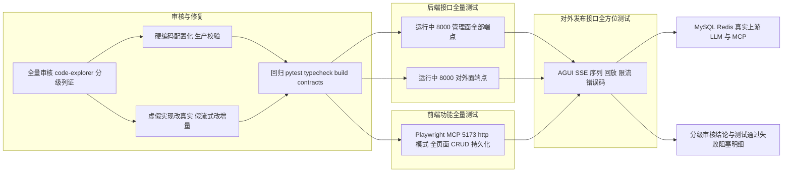

## User Requirements

对 Albedo 项目前后端做全量审核，识别「虚假实现 / stub 占位 / 假数据」与「硬编码（凭据、地址、演示值）」；对发现的问题**全面修复**（改为真实实现、配置化）；随后按顺序完成四阶段验证：后端接口全量测试、使用 Playwright MCP 的全量功能测试、AGUI 等对外发布接口全方位测试，并输出分级结论。

## Product Overview

交付一份可执行、可追溯的「审核 → 修复 → 回归 → 三层测试 → 结论」闭环：审核结果按严重程度分级并附带文件与行号证据；修复在保持现有双模式与离线测试能力的前提下，让在线/真实模式不再返回伪装数据；测试直接面向当前已运行的系统，覆盖管理面全部端点、前端全部页面功能、对外发布接口全套（含 SSE 事件序列、断点回放、鉴权、限流、错误码与真实上游链路）。

## Core Features

- 前后端全量审核：虚假实现、stub/降级、占位文案、明文凭据、硬编码地址与演示值逐项分级列证。
- 全面修复：假数据连接测试、假流式、静默降级改为真实链路；硬编码统一配置化并加生产启动校验；文档矛盾与契约同步更正。
- 后端接口全量测试：管理面与对外面全部端点的成功、边界、鉴权、错误码、幂等与并发用例。
- 前端全量功能测试：登录、概览、智能体、四类资源、日志、设置、全局搜索、通知、增删改查与刷新持久化，并用控制台与响应断言辅助判定。
- 对外发布接口全方位测试：AGUI SSE、`/v1/agents/{id}/chat`、`/v1/chat/completions`、`/v1/embeddings`、`/v1/models` 的事件序列、`sequence` 单调、`Last-Event-ID` 回放、限流与错误码。
- 数据与安全约束：测试数据统一 `QA-` 前缀标记且不清理；允许真实上游调用；凭据不落仓库、不进日志；破坏性用例放到最后并单列副作用。

## Tech Stack Selection

全部复用现有栈，不引入新框架：

- 后端：Python 3.12 + FastAPI + SQLAlchemy 2.0 + pydantic-settings（`Settings` / `get_settings()`）+ LangGraph（`RuntimeEngine`）+ httpx；包管理 `uv`，测试 `pytest`。
- 前端：React 18 + TypeScript 5.7 + Vite 5 + Zustand；`npm run typecheck` / `build` 做静态回归。
- 契约：`packages/contracts/openapi.json` + `generate.sh --check` + `backend/scripts/export_openapi.py`。
- 测试执行：新增的 HTTP 全量测试脚本用后端已有 `httpx.AsyncClient`（对齐 `tests/conftest.py` 的 httpx 用法）；浏览器测试用 Playwright MCP Server 工具；离线回归仍用 `uv run pytest -q`。

## Implementation Approach

**总体策略**：五阶段顺序执行（审核 → 修复 → 回归 → 后端接口全量测试 → Playwright 全量功能测试 → 对外发布接口全方位测试 → 汇总）。审核与测试均面向当前已运行的系统（后端 `localhost:8000` 为 `UPSTREAM_MODE=live`，前端 `localhost:5173` 为 `VITE_API_MODE=http`）。

**关键决策一：区分「设计内降级」与「伪装成真实结果的假实现」，避免一刀切删除。** 已核实 `backend/tests/conftest.py:11-20` 强制离线 stub、`README.md:46-60` 明示前端 mock 双模式、`config.py:20` 默认 `upstream_mode="stub"`，这些是可回退的产品能力与离线测试基座，删除会破坏回归与向后兼容。因此修复定义为：(a) 消除返假数据的路径——`adapters/stub.py` 中 `StubModelGateway.test_connection` 用 `fail|timeout` 正则伪造成功并硬编码 `latencyMs: 782`、`StubMcpGateway.discover_tools` 返回固定 `DISCOVERED_TOOLS`、`StubToolGateway.list_tools` 恒返空；`runtime/tools.py` 中 `stub_runner` 伪造 `resultCount: 5`；(b) 确保 live 模式连接测试与工具调用强制走 `LiveModelGateway` / `live_tool` 的真实链路，复用 `core/network.py` 的 `assert_public_url` 做 SSRF 防护并加超时；(c) 保留的 stub/降级必须显式标注 `mode=offline` 或 `degraded` 并写可观测日志，禁止在生产静默降级；(d) 对 `skill_runner`（加载指令供模型遵循，属 prompt 注入的合理设计）逐一核实后再决定是否改动，避免误伤。`degraded_runner` 的「暂未接入真实实现」文案改为明确的降级原因与状态。

**关键决策二：精确修复假流式。** 已核实 `api/public/agents.py:82-89` 的 `chat_sse` 在 `execute_agent_run` 跑完整轮后把 `content` 按 24 字符切片，是假流式（首字节延迟高、内存 O(n) 缓冲）；而 `runtime/engine.py:233` 的 `RuntimeEngine.run_stream` 基于 `astream_events` 是真 token 级增量。修复方式：让 `stream=true` 复用 `agui_stream` 已验证的 `run_stream` + `persist_result` 模式与 `to_agui_events` 事件映射思路，改为真增量流式并保留结果持久化与日志写入时机，将首 token 延迟与缓冲从 O(n) 降为增量 O(1)。同时更正 `backend/README.md:94` 与 `:121` 关于 AGUI「token 级增量 / 完成后分块」的自相矛盾描述。

**关键决策三：硬编码全量配置化 + 生产启动校验。** `config.py:17-18` 的 `database_url` / `redis_url` 默认含明文账号、`config.py:30` 的 `demo_access_key="albedo-demo-2026"`、`secret_key=""` 空默认，统一改为环境变量注入；用 pydantic 校验在 `environment` 非 dev 时强制要求 `secret_key`、DB/Redis 连接与上游 Key，缺失即启动失败，避免默认值泄漏到生产。`docs/运维信息.md` 中明文 MySQL / Redis / 上游 Bearer 凭据移除或脱敏为「从安全渠道注入」说明（与 `README.md:25` 的声明一致）。`db/seed_data.py`、`frontend/src/mock/seed.ts` 的 `api.albedo.local`、`mcp.internal.local`、Bearer 样例头，`CodeSample.tsx:12`、`CreateModelDialog.tsx`、`CreateMcpDialog.tsx` 的预置地址，改为从工作区设置 / 环境变量读取。`get_settings()` 的 `lru_cache` 保持不变，不增加热路径开销。

**关键决策四：测试双层覆盖 + 可复现产物。** 离线层用现有 `pytest`（契约、认证、运行时、安全）做修复回归；在线层新增模块化 HTTP 测试脚本直连运行中的 8000，覆盖真实 DB 与 live 上游。所有写操作创建的数据统一 `QA-` 前缀且**不清理**（遵循用户选择）；`POST /api/v1/settings/reset-demo` 会清空现有真实调用记录、`credential/reset` 与 `key/rotate` 会使旧 Token 失效，这两类破坏性用例放到最后执行并单独列出副作用。对外面 Bearer Token 通过管理面 `credential/reset` 或 `publications/{id}/key/rotate` 现场签发（完整值仅返回一次），只在内存中传递、报告仅保留后缀。

**Performance & Reliability**：连接测试改真实网络后需复用 SSRF 校验与超时，避免慢上游拖垮接口；测试脚本复用 `httpx.AsyncClient` 连接池、按端点分组串行、组内适度并发，QPM 限流用例单独控频以免误伤其它用例；SSE 测试按事件流增量读而非整体缓冲；报告聚合复杂度 O(用例数)，不做重复全量遍历；日志与报告不打印任何 Token / 密钥明文。

## Implementation Notes

- **复用既有约定**：统一错误体走 `core/errors.py` 的 `ApiException`；鉴权复用 `api/public/deps.py` 的 `require_agent` / `require_publication`；限流复用 `core/ratelimit.py` 的 `allow_qpm`；AGUI 事件缓存复用 `runtime/event_store.py` 的 `append_events` / `load_events`；配置统一走 `get_settings()`，不新增读取入口。
- **Blast radius 控制**：不改端口、路由前缀、请求/响应结构与 OpenAPI 契约语义；若修复仅涉及内部实现，`generate.sh --check` 应保持通过；保留 `UPSTREAM_MODE=stub` 与前端 `mock` 模式的回退能力，仅在返回值中显式标注 offline，避免破坏 `conftest.py` 的离线夹具。
- **日志与脱敏**：新增降级日志只记录工具名、原因与耗时，不记录凭据或完整上游响应；测试结果中凭据一律用 `credentialSuffix` 后缀；避免每个用例重复打印大 payload。
- **破坏性操作保护**：`reset-demo`、`access-key` 修改、`credential/reset` 集中到测试末段；`reset-demo` 前记录当前调用记录数量以便对比评估影响；不执行任何清理动作。
- **回归门禁**：修复后先跑 `uv run pytest -q`、`npm run typecheck`、`npm run build`、`bash packages/contracts/generate.sh --check` 与 `GET /health`，全部通过再进入三层在线测试，避免带病测试放大噪音。

## Architecture Design



被测面分三组：`/api/v1/**`（Cookie 会话，14 个路由模块）、`/v1/**` 与 `/api/agui/v1/**`（Bearer Token，Agent Token 与 Publication Key 两套隔离鉴权）、前端 `http` 模式页面（经 Vite 代理到 8000）。修复只落在实现层，不改上述边界。

## Directory Structure

### 修复目标（后端硬编码与虚假实现）

```
backend/
├── app/core/config.py                      # [MODIFY] 去除 database_url/redis_url 明文账号、demo_access_key 明文与 secret_key 空默认；改为环境变量注入，新增非 dev 环境必填校验；保留 get_settings 的 lru_cache 与 fernet_key/session_cookie_name 契约不变。
├── .env.example                            # [MODIFY] 去掉 DEMO_ACCESS_KEY 明文示例，补充生产必填项与占位说明，保持与 .env 字段一致。
├── app/adapters/stub.py                    # [MODIFY] StubModelGateway.test_connection / StubMcpGateway.discover_tools / StubToolGateway.list_tools 不再返回伪造成功与固定列表；改为真实探测或显式 offline 标注；核实 get_*_gateway 在 live 下强制走 Live* 实现。
├── app/api/public/agents.py                # [MODIFY] chat_sse 改为复用 RuntimeEngine.run_stream 的真增量流式，保留 persist_result 与日志时机；agui_stream / to_agui_events / replay_agui 保持契约，仅修正错误分支与事件一致性。
├── app/runtime/tools.py                    # [MODIFY] stub_runner 去除伪造结果；degraded_runner 返回明确状态与原因而非静默成功；skill_runner 核实后决定是否保留；live 模式禁默降级。
├── app/api/v1/models.py                    # [MODIFY] 核实连接测试端点在 live 下走真实网关，修正 summary 中的 stub 标注。
├── app/api/v1/mcps.py                      # [MODIFY] 同上，工具发现与连接测试不再返回固定假数据。
├── app/api/v1/agents.py                    # [MODIFY] 修正 summary stub 标注，确认 test-runs 使用真实引擎。
├── app/db/seed_data.py                     # [MODIFY] api.albedo.local/mcp.internal.local/Bearer 样例头等硬编码改为配置或明确演示占位标识。
└── scripts/e2e/                            # [NEW] 在线全量测试脚本包（见下）。
```

### 修复目标（前端硬编码与占位文案）

```
frontend/
├── .env.example                            # [MODIFY] 去掉 VITE_DEMO_ACCESS_KEY 明文演示值，改为留空并注明仅本地开发可填。
├── src/mock/seed.ts                        # [MODIFY] 平台域名、MCP 内网地址、演示 Key 等硬编码改为从配置/工作区设置读取。
├── src/components/common/CodeSample.tsx    # [MODIFY] endpointOf 生成的发布域名改从设置读取，不写死占位域名。
├── src/pages/models/CreateModelDialog.tsx  # [MODIFY] 预置 baseUrl 硬编码改为可配置默认值。
├── src/pages/mcp/CreateMcpDialog.tsx       # [MODIFY] 预置 endpoint 硬编码改为可配置默认值。
├── src/pages/models/ModelDetailDrawer.tsx  # [MODIFY] 占位配置文案改为真实字段说明或明确标注。
├── src/pages/agents/CapabilitiesPanel.tsx  # [MODIFY] 「暂未挂载」占位文案核实后改为真实状态展示。
└── src/pages/agents/PublishTab.tsx         # [MODIFY] 环境变量占位文案改为真实接入指引。
```

### 文档、契约与测试产物

```
docs/运维信息.md                            # [MODIFY] 移除明文 MySQL/Redis/上游 Bearer 凭据，改为「从安全渠道或环境变量注入」的说明，消除与 README 声明的冲突；不新增 md 报告文件。
backend/README.md                           # [MODIFY] 修正 M5「尚未实现」与 M5a/M5b「已落地」矛盾、AGUI 流式描述矛盾、未做项清单。
README.md                                   # [MODIFY] 同步修正演示 Key 明文与范围表述中的过时内容。
packages/contracts/openapi.json             # [MODIFY-生成] 若签名变动，用 export_openapi.py 重新导出并以 generate.sh --check 校验一致性。
backend/scripts/e2e/common.py               # [NEW] 公共夹具：httpx.AsyncClient 连接复用、管理面登录取 Cookie、QA- 前缀数据工厂、Bearer 现场签发、结果聚合与脱敏（仅后缀）、退出码与结构化报告输出。
backend/scripts/e2e/admin_api.py            # [NEW] 管理面全端点测试：认证/会话、bootstrap、四类资源 CRUD 与启停、模型发布与密钥轮换、Agent 全生命周期、日志/导出/下载、统计/搜索/通知/设置；覆盖成功、边界、错误码、并发 stale_version。
backend/scripts/e2e/public_api.py           # [NEW] 对外面测试：/v1/agents/{id}/chat（stream 与非 stream）、/v1/chat/completions、/v1/embeddings、/v1/models；覆盖 Bearer 鉴权、跨 Agent 越权、未发布、QPM 限流、上游错误映射、参数与 Header 透传。
backend/scripts/e2e/agui_api.py             # [NEW] AGUI 全方位测试：SSE 事件序列与 sequence 单调、X-AGUI-Version 头、RUN_FINISHED/RUN_ERROR、TOOL_CALL_*、Last-Event-ID 断点回放、协议开关、鉴权与限流、真实上游 token 增量。
backend/scripts/e2e/run_all.py              # [NEW] 编排入口：按 admin → public → agui 顺序执行，破坏性用例置末，汇总分级通过/失败/阻塞明细并输出结论数据（不打印凭据）。
```

前端 Playwright 测试通过 [mcp:Playwright MCP Server] 直接操作运行中的 5173 完成，不强制落盘测试文件；如需要可复现产物，可用其 `start_codegen_session` / `end_codegen_session` 导出 `frontend/e2e/full_functionality.spec.ts`。

## Agent Extensions

### MCP

- **Playwright MCP Server**
- Purpose: 对 `http://localhost:5173`（http 模式）执行全量功能测试，并用其 HTTP 工具（`playwright_post` / `playwright_get` / `playwright_expect_response` / `playwright_assert_response`）辅助验证 AGUI SSE 与 `/v1/**` 对外发布接口。
- Expected outcome: 覆盖登录、全部页面与 CRUD/持久化，产出可见文本、控制台错误、响应断言与截图证据；对外面接口得到可核验的请求/响应结果，形成前端与对外面的完整通过/失败清单。

### SubAgent

- **code-explorer**
- Purpose: 以 very thorough 级别跨前后端全库扫描 stub/占位/假数据、硬编码凭据与地址、文档矛盾，并按调用链核实每一处是否在生产链路生效。
- Expected outcome: 产出带绝对路径与行号、按严重程度分级的审核证据清单，明确哪些属设计内离线降级、哪些属需修复的虚假实现。

### MCP

- **Sequential Thinking**
- Purpose: 编排「审核 → 修复 → 四阶段测试」的多步推理，动态修正审核判定与测试阻塞归因，过滤无关信息。
- Expected outcome: 形成可追溯的分级结论与失败归因链，避免把限流误判、上游波动误报为实现缺陷。

### MCP

- **Context7**
- Purpose: 修复真流式与对外透传时查证 FastAPI `StreamingResponse`、LangGraph `astream_events`、OpenAI 兼容流式与 SSE 断线回放的最新 API 用法。
- Expected outcome: 修复实现与测试断言基于准确的框架行为，避免因 API 版本差异产生回归或误判。