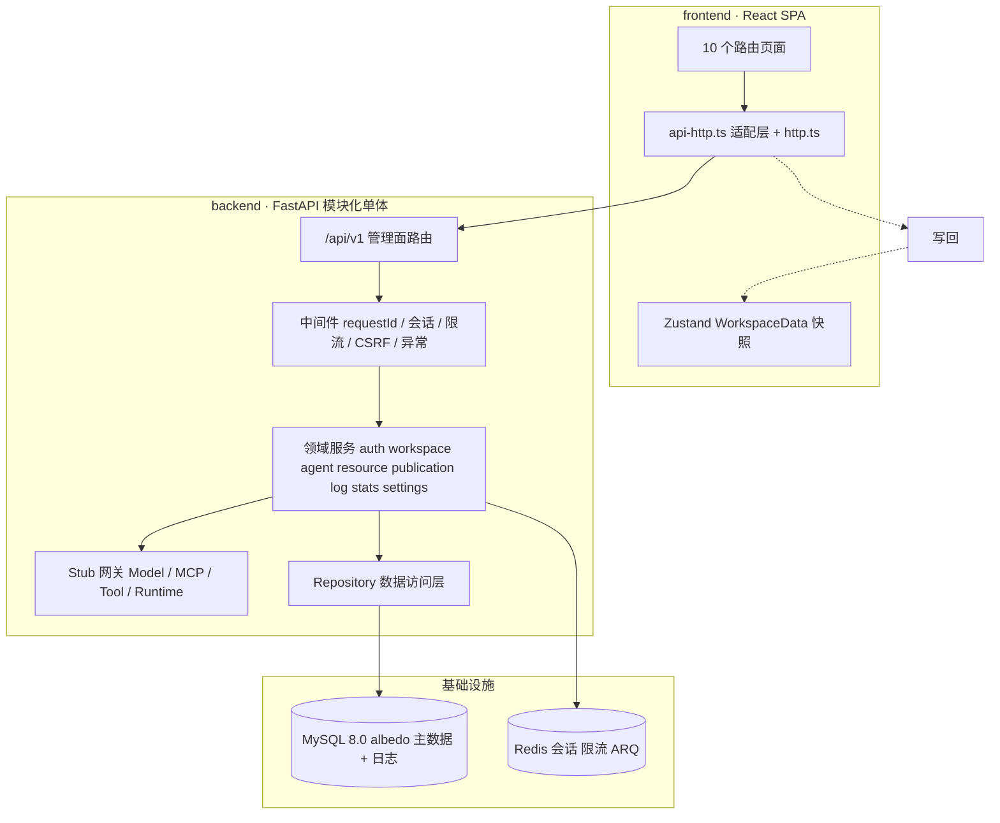

## Product Overview

按 `docs/后端实施计划.md` 的里程碑顺序，**分步骤完成 albedo 后端管理面 M0–M4**，并同步改造前端以真实调用后端；最后**真实连接已有 MySQL `albedo` 库执行建表与演示数据填充**。每一步产出可运行结果并验证后再进入下一步。

## Core Features

- **M0 契约冻结**：Python 3.12 + FastAPI 骨架、Pydantic v2 请求/响应模型、导出 OpenAPI 3.1 快照；前端新增 HTTP 适配层与 `VITE_API_MODE=mock|http` 双模式开关、Vite 代理，页面与 `domain.ts` 类型保持不变。
- **M1 基础设施与认证**：SQLAlchemy 2.0 异步模型 + Alembic 迁移、Redis 会话/限流、Argon2id 访问 Key、HttpOnly Cookie 会话、登录限流、structlog(`requestId`)、ARQ worker 骨架；`GET /api/v1/workspace/bootstrap` 返回与 `WorkspaceData` 同构的全量快照且**不含明文访问 Key**；前端登录、启动水合、路由守卫接入。
- **实际数据库操作**：在目标库执行 DDL 建表、执行 DML 写入 12 类实体 seed 数据，并用只读 SQL 与 bootstrap 接口逐表核对，seed 可幂等重跑。
- **M2 资源域**：Model / MCP / Skill / BuiltinTool 的 CRUD、启停、额度、引用分析、凭证保险库、Skill 上传校验；连接测试与工具发现采用**可插拔 stub 适配层**，离线可跑通且保留后续 LangChain/MCP/LangGraph 接口形状。
- **M3 Agent 与发布配置**：Agent CRUD、乐观锁、配置快照、Jinja2 变量校验、发布前检查、双协议开关、凭证重置、模型多版本发布与 Key 轮换、对话历史。
- **M4 日志与治理**：服务端日志分页/筛选/执行链路、统计与趋势、全局搜索、通知、设置、异步导出与签名下载、保留清理 cron，敏感信息统一脱敏。
- **验证与范围边界**：pytest/契约测试、只读 SQL 核对、curl 与浏览器双模式端到端联调；`mock` 模式行为与改造前一致。暂不实现 LangGraph 运行引擎、AGUI/SSE、对外 `/v1/**` 网关与 M6 安全压测；测试会话 `chat.send` 本阶段仍走本地模拟并明确标注为 M5a 接入点。

## Tech Stack Selection

严格复用文档既定选型与现有前端栈，不引入新框架：

- **后端**：Python 3.12（`/Users/yearton/.local/bin/python3.12`）+ `uv`/`uv.lock` + FastAPI + Uvicorn + Pydantic v2 + `pydantic-settings`。
- **数据层**：SQLAlchemy 2.0 async + Alembic + `asyncmy`（若安装失败降级 `aiomysql`）+ MySQL 8.0；`redis-py` asyncio 用于会话/限流/队列；ARQ 作后台任务与 cron。
- **安全与可观测**：`argon2-cffi`（Argon2id + `hmac.compare_digest`）、`cryptography` Fernet（五类凭证信封加密）、structlog + `contextvars`。
- **适配层**：`httpx`（仅保留 SSRF 白名单校验与转发接口，默认 stub 不发真实请求）；以 `typing.Protocol` 定义 Model/MCP/Tool/Runtime 网关，M5 可替换。
- **测试**：pytest + pytest-asyncio + `httpx.ASGITransport` + schemathesis 骨架。
- **前端（现有）**：React 18 + TypeScript + Vite 5 + Zustand 5 + Tailwind 3；仅新增 `src/lib/http.ts`、`src/lib/api-http.ts`，不新增组件库。
- **契约**：`packages/contracts/openapi.json` 快照 + 生成脚本；前端 `domain.ts` 保持为人工契约基线（避免生成类型引发动荡）。

## Implementation Approach

**策略：先快照、后分片；契约优先、逐里程碑验证；写边界收口到适配层。**

1. **不改页面渲染逻辑**：前端唯一的写边界 `mockApi.*` 26 个命令签名全部保留。`frontend/src/lib/api-http.ts` 按命令调用 `/api/v1/**`，成功后用现有 `useWorkspace.getState()` action 把返回值写回 Zustand（与文档 5.1「适配层写回 Zustand」一致），再返回与原命令完全相同的类型。相比「每次写操作重新拉全量 bootstrap」，此方案避免额外往返且不会冲掉测试会话消息；代价是适配层需镜像各命令的 store 副作用，集中在单一新文件内可控。
2. **bootstrap 在 M0–M4 保持全量快照**：M1–M4 的 `computeStats`/`filterLogs`/`globalSearch`/`getTrend` 继续在前端基于快照本地派生，因此 `OverviewPage.tsx`、`LogsPage.tsx` 等 `.tsx` 无需改写，双模式回归风险最低。M4 的服务端日志分页、统计、搜索接口**完整实现并通过契约/接口测试验证**，同时在 `api-http.ts` 暴露 `logs.query`/`stats.overview`/`stats.trends`/`search` 就绪接口，页面切换分片留作后续（本次用户选定的前端范围仅为文档 1.2 的 6 处改造）。此为对文档第 4 节「M4 起日志分片」的有意取舍，需明确记录。
3. **数据库为唯一事实源**：`albedo` 库经只读探测确认为空库，可直接 `alembic upgrade head`，不会覆盖数据。凭据仅从被 `.gitignore` 忽略的 `backend/.env` 读取，命令行用 `MYSQL_PWD` 避免回显；明文口令不写入任何代码、提交、文档或日志。
4. **stub 可插拔**：`UPSTREAM_MODE=stub` 时 `models/test`、`mcps/test`、工具发现返回符合接口文档的 `latencyMs`/`httpStatus`/`errorCategory`/`toolCount`，不发起外部网络调用；网关 Protocol 与 LangChain `init_chat_model`、`MultiServerMCPClient`、LangGraph `StateGraph` 的语义对齐，M5 仅替换实现。
5. **会话与限流的可靠性**：`sessions` 表为会话权威存储（服务重启不丢登录态），Redis 仅作加速与失败计数；Redis 不可用时限流降级为进程内计数，避免全线 500。ARQ 失败不影响主请求。
6. **性能**：bootstrap 用单 `AsyncSession` 按表批量查询（约 20 条 SQL，`selectinload` 预载 `mcp_tools`/`skill_versions`/`agent_mounts`），杜绝 N+1；复杂度 O(实体总行数)，单用户规模下 <100ms。`log_entries` 建 `(run_id, timestamp)` 与 `(type, status, timestamp)` 联合索引，分页用 `LIMIT/OFFSET` + 单次 `COUNT(*)`，`typeCounts` 用一条 `GROUP BY`；趋势复用 `trend_daily` 聚合而非全表扫描。写操作统一 `async with session.begin()` 单事务（实体 + 系统审计日志 + `version+1`），避免半写。

## Implementation Notes

- **必须真实操作数据库**：`backend/scripts/init_db.py` 串起 `alembic upgrade head` → 幂等 seed → 校验输出；验收口径为 `SHOW TABLES` 与逐表 `SELECT COUNT(*)`（agents=4、models=4、publications=3、mcps=3、mcp_tools=7、skills=4、builtin_tools=6、log_entries=12、notifications=2、workspace_settings=1、credentials>=1、trend_daily=30、export_tasks=0），并调用 bootstrap 比对数量；重跑 seed 行数不变。
- **seed 数据镜像**：`backend/app/db/seed_data.py` 静态镜像 `frontend/src/mock/seed.ts` 的 12 类实体，ID 前缀与取值逐字保持一致（`agt-research`、`mdl-gpt`、`albedo-gpt-4.1`、`mcp-tavily`、`run_8fk2m1`、`log-1001`… 等），相对时间在 seed 执行时按 UTC 生成；`settings.accessKey` 明文**不落库**，改为在 `credentials` 表存 `albedo-demo-2026` 的 Argon2id hash + 后缀 `K9P4`，并从 bootstrap 响应剔除，仅保留 `accessKeySuffix`。适配层水合时补 `accessKey: ''` 以满足 `WorkspaceSettings` 类型。
- **避开文档三个坑**：`chat.send` 在 http 模式仍用 `sendTestMessage`（其已调用 `appendChatMessages` 写回 `chatSessions`，`TestChatPanel` 才能刷新）；bootstrap 绝不下发明文 Key；M0–M3 不动 `stats.ts`/`selectors.ts`。
- **直写 store 的少量收口**（各 1–2 行，属适配必需，非页面重写）：`NotificationPanel.tsx`（`markAllNotificationsRead`）、`TestChatPanel.tsx`（`clearChat`）、`SettingsPage.tsx`（`resetDemo` 后的 `patchSettings` 保护）、`ChangeKeyDialog.tsx` 与 `LoginPage.tsx`（http 模式不读取明文 Key，改用 `VITE_DEMO_ACCESS_KEY`）。`store/auth.ts` 保留 `failedAttempts`/`lockedUntil` 供 `mock` 模式回归，http 分支忽略并由服务端 429 驱动。
- **`logs.export` 兼容**：保持 `mockApi.logs.export(logs, format, filtersLabel)` 签名不变，http 分支 POST `{format, filters, logIds}`，后端按 `logIds` 从库取值并脱敏生成文件、记录 `filters` 标签、返回 `ExportTask` 后再轮询/下载。
- **错误与日志**：统一 `{error:{code,message,requestId}}` → `ApiError(code,message)`，页面现有 `asError(reason).message` 不动；管理面错误码严格取自接口文档 4.1，不混用对外码。structlog 只记录 ID/后缀/耗时，脱敏后再写 `input_summary`/`output_summary`，禁止大 payload 与 PII。
- **blast radius**：`VITE_API_MODE=mock` 为默认回退档，M6 前保留；不改动任何 `.tsx` 渲染结构、不重构 `runtime.ts`/`stats.ts`/`domain.ts`；Cookie 的 `Secure` 在本地 http 下由配置关闭以便开发；`backend/.env`、`.env.local` 已被根 `.gitignore` 覆盖，无需改忽略规则。

## Architecture Design



分层规则：页面只经 `api-http.ts` 访问管理面；`api/v1` 路由 → 中间件 → 服务 → Repository → MySQL；所有外部上游收敛到 `GW` Protocol；会话权威在 MySQL，Redis 为加速与队列。管理面与对外面依赖链隔离，本次不注册任何 `/v1/**` 对外路由。

## Directory Structure

```
albedo/
├── backend/                                      # [NEW] Python 3.12 + FastAPI 后端工程
│   ├── pyproject.toml                            # [NEW] uv 项目与依赖声明（FastAPI/SQLAlchemy/Alembic/asyncmy/redis/ARQ/argon2/cryptography/structlog/httpx/pytest）
│   ├── uv.lock                                   # [NEW] 锁定依赖版本，避免 LangChain 生态漂移与不可复现安装
│   ├── .env.example                              # [NEW] 环境变量模板（占位符，绝不含真实口令）
│   ├── .env                                      # [NEW] 本地真实连接串，已被根 .gitignore 忽略，不入库
│   ├── alembic.ini                               # [NEW] Alembic 配置，迁移目标指向 albedo 库
│   ├── alembic/
│   │   ├── env.py                                # [NEW] 异步引擎迁移环境，从 Settings 读 DATABASE_URL
│   │   └── versions/0001_initial_schema.py      # [NEW] 初始 DDL：约 20 张表、JSON 列、联合唯一/索引约束
│   ├── app/
│   │   ├── main.py                               # [NEW] FastAPI 应用装配：路由、中间件、全局异常处理、/openapi.json
│   │   ├── core/
│   │   │   ├── config.py                         # [NEW] pydantic-settings：DB/Redis/Fernet 主密钥/Cookie/UPSTREAM_MODE/CSRF 开关
│   │   │   ├── security.py                       # [NEW] Argon2id、恒定时间比对、Fernet 信封加密、不透明会话、CSRF
│   │   │   ├── errors.py                         # [NEW] 管理面错误码枚举与 {error:{code,message,requestId}} 处理
│   │   │   └── logging.py                        # [NEW] structlog + contextvars 注入 requestId，统一脱敏管线
│   │   ├── db/
│   │   │   ├── base.py                           # [NEW] DeclarativeBase、公共列、命名约定
│   │   │   ├── session.py                        # [NEW] async_engine / async_sessionmaker / 依赖注入
│   │   │   ├── models/                           # [NEW] 按域拆分的 20 张表声明式模型（workspace_settings/credentials/sessions/agents/agent_mounts/models/model_publications/mcp_servers/mcp_tools/skills/skill_versions/builtin_tools/runs/chat_messages/log_entries/export_tasks/notifications/trend_daily/mcp_call_records 等）
│   │   │   ├── seed_data.py                      # [NEW] 静态镜像 frontend/src/mock/seed.ts 的 12 类实体与相对时间
│   │   │   └── seed.py                           # [NEW] 幂等 upsert seed（含访问 Key hash 与后缀），供 init 与 reset-demo 复用
│   │   ├── schemas/                              # [NEW] Pydantic v2：domain.py（对齐 WorkspaceData 12 类实体）、requests.py、responses.py
│   │   ├── repositories/                         # [NEW] Repository 接口 + SQLAlchemy 实现，批量查询/预载避免 N+1
│   │   ├── services/                             # [NEW] auth / workspace / agents / resources / publications / credentials / logs / stats / notifications / settings / exports
│   │   ├── adapters/
│   │   │   ├── base.py                           # [NEW] ModelGateway、McpGateway、ToolGateway、RuntimeGateway 的 Protocol 定义
│   │   │   └── stub.py                           # [NEW] 离线 stub 实现，返回符合接口文档的延迟/工具数/错误分类
│   │   ├── api/v1/                               # [NEW] 管理面路由：router.py + auth/workspace/agents/models/mcps/skills/tools/resources/logs/stats/notifications/settings
│   │   ├── middleware/                           # [NEW] requestId、会话鉴权、Redis 限流、CSRF、写操作审计日志
│   │   └── worker.py                             # [NEW] ARQ WorkerSettings + 每日保留清理/归档 cron 骨架
│   ├── scripts/init_db.py                        # [NEW] 真库入口：建库表 → 填充 seed → 逐表计数校验 → 输出可复核报告
│   ├── tests/                                    # [NEW] conftest.py + auth/bootstrap/resources/agents/logs 用例 + schemathesis 契约骨架
│   └── README.md                                 # [NEW] 后端启动、迁移、seed、双模式联调命令
├── packages/contracts/
│   ├── openapi.json                              # [NEW] FastAPI 导出的 OpenAPI 3.1 契约快照，纳入版本管理
│   └── generate.sh                               # [NEW] 重新导出契约快照的脚本（CI 校验用）
├── frontend/
│   ├── vite.config.ts                            # [MODIFY] server.proxy 将 /api 与 /v1 代理到 http://localhost:8000
│   ├── .env.example                              # [NEW] VITE_API_MODE / VITE_DEMO_ACCESS_KEY 模板
│   ├── package.json                              # [MODIFY] 增补契约生成等脚本（不新增运行时依赖）
│   └── src/
│       ├── lib/http.ts                           # [NEW] fetch 封装：credentials:include、requestId、CSRF、超时、错误转 ApiError
│       ├── lib/api-http.ts                       # [NEW] 26 个命令的 HTTP 实现 + 写回 Zustand + logs/stats/search 就绪接口
│       ├── mock/api.ts                           # [MODIFY] 保留 mockApi 全部签名，按 VITE_API_MODE 分派到 api-http 或原 mock 实现
│       ├── main.tsx                              # [MODIFY] 启动水合 bootstrap → replaceAll，401 跳登录，加载骨架屏
│       ├── App.tsx                               # [MODIFY] 路由守卫改由 auth/session 驱动
│       ├── store/auth.ts                         # [MODIFY] http 模式忽略本地失败计数，新增 setAuthenticated
│       ├── pages/LoginPage.tsx                   # [MODIFY] 去掉明文 Key 预填/比对，提交 auth.login
│       ├── pages/settings/ChangeKeyDialog.tsx    # [MODIFY] 不读 settings.accessKey，完全依赖服务端校验
│       ├── pages/SettingsPage.tsx                # [MODIFY] resetDemo 后的本地 patchSettings 做兼容保护
│       ├── pages/agents/TestChatPanel.tsx        # [MODIFY] clearChat 收口到 mockApi 命令
│       └── components/layout/NotificationPanel.tsx # [MODIFY] 全部已读收口到 mockApi 命令以持久化
└── README.md                                     # [MODIFY] 补后端/迁移/seed/双模式运行说明，更新仓库结构
```

## Key Code Structures

仅给出决定后续可扩展性的抽象网关契约（接口级，无实现）：

```python
from typing import Protocol, Any

class ModelGateway(Protocol):
    async def test_connection(self, draft: dict[str, Any]) -> dict[str, Any]: ...
    # 返回 latencyMs / httpStatus / errorCategory / responseSummary；M5 由 ChatOpenAI 实现

class McpGateway(Protocol):
    async def discover_tools(self, draft: dict[str, Any]) -> list[dict[str, Any]]: ...
    # 返回工具 name/key/description 列表；M5 由 MultiServerMCPClient 实现

class RuntimeGateway(Protocol):
    async def run(self, agent_id: str, content: str, model_id: str) -> dict[str, Any]: ...
    # 返回 SendResult 结构；M5a 由 LangGraph StateGraph 实现，本阶段用本地模拟
```

统一错误体契约：`{"error": {"code": str, "message": str, "requestId": str}}`，由 `http.ts` 转成 `ApiError(code, message)`。

## Agent Extensions

### SubAgent

- **code-explorer**（very thorough）
- Purpose: 在实现前全面核对 26 个 `mockApi.*` 命令签名、全部调用点、直写 Zustand 的旁路调用，以及 `domain.ts` 12 类实体与 `seed.ts` 字段。
- Expected outcome: 产出精确的「命令→接口→store 副作用」映射清单，确保 `api-http.ts` 零遗漏、页面无需重写。

### MCP

- **Context7**
- Purpose: 先用 `resolve-library-id` 获取 FastAPI、SQLAlchemy 2.0、Alembic、Pydantic v2、ARQ、argon2-cffi、structlog、LangChain/LangGraph 的库 ID，再 `query-docs` 核对异步会话、迁移、Cookie 会话、StateGraph 等 API 用法。
- Expected outcome: 后端脚手架与网关抽象使用当前版本正确 API，规避版本漂移导致的返工。
- **Playwright MCP Server**
- Purpose: 在最终联调阶段用浏览器分别以 `mock` 与 `http` 模式走登录 → bootstrap → 创建/编辑 Agent 与模型 → 日志筛选 → 设置保存 → 刷新保留，并用 `playwright_console_logs` / `playwright_assert_response` 校验。
- Expected outcome: 双模式端到端流程通过、`http` 模式数据来自数据库、`mock` 模式行为无回归的可复核结论。