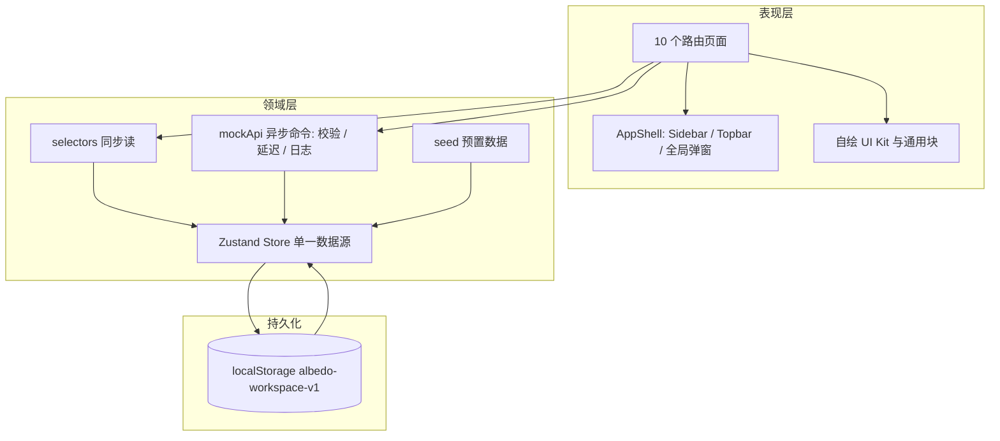

## 用户要求

依据 `docs/智能体开发平台-产品文档.md`，从零完成 albedo 智能体开发平台的全部前端页面，覆盖产品文档定义的 9 大功能模块与 3 个全局组件，所有增删改查、筛选、启停、发布、调试等交互均可操作。后端能力以演示数据驱动，操作即时生效、刷新后状态保留，并可一键重置演示数据。视觉以 `docs/screenshots/` 下 40 张原型截图为基线还原。

## 产品概述

面向个人单用户的「个人 AI 能力工作台」，覆盖「资源接入 → 智能体编排 → 标准化发布」完整闭环：访问 Key 登录、工作台概览、智能体管理（列表、配置、即时调试、对话历史、发布）、能力资源池（MCP、Skills、内置工具、模型）、全链路调用日志与系统设置。界面为桌面管理台形态：近黑固定侧栏分三组导航、吸顶面包屑顶栏、浅灰内容区配白色圆角卡片、紫色主色点缀，信息密度高、状态标签语义清晰，含渐变头像、趋势折线、代码块、弹窗与抽屉；移动端导航抽屉化、窄屏布局自适应。

## 核心功能

- 登录与全局框架：访问 Key 校验、分组导航与高亮、⌘K 全局搜索、通知面板、帮助弹窗、右上角 Toast 反馈与危险操作二次确认。
- 工作台概览：四项核心指标、14/30 天调用趋势、资源健康状态、最近活动与快捷入口。
- 智能体：卡片列表与组合筛选、创建流程、三栏编辑器（基础信息、提示词变量、模型参数、能力挂载、高级设置）、多轮测试会话、对话历史，以及标准对话 API 与 AGUI 双协议独立发布、脱敏凭证、快速接入示例与完整接口文档。
- 能力资源：MCP 接入测试与工具启停、Skill 拖拽上传与详情、内置工具全局启停与影响提示。
- 模型管理：OpenAI 兼容模型接入、连接测试、备注与配置，以及同一模型的多版本发布（独立调用标识、密钥、请求头、生成参数、QPM 与启停）。
- 调用日志与设置：六类日志组合筛选、分页、按 runId 聚合的执行链路详情与导出，工作区信息、访问 Key 修改、日志保留策略与重置演示数据。

## 技术栈选型

- **React 18 + TypeScript + Vite**：用户已确认；Vite 提供秒级启动与构建，`npm install && npm run dev` 即可运行。
- **Tailwind CSS**：以 `tailwind.config.js` 集中承载设计令牌（色板、圆角、阴影、字号、动画），CSS 变量同步用于自绘组件。版本与配置写法由 `[mcp:Context7]` 核对最新官方文档后确定。
- **react-router-dom**：采用 `createBrowserRouter` 数据路由，因其 `useBlocker` 能原生实现「编辑器未保存修改离开拦截」（文档 8.4 要求），避免自研导航守卫。
- **Zustand + persist**：单一规范化数据源 + `localStorage` 持久化，天然满足「刷新保留 / 重置演示数据 / 跨模块引用一致性」。单个 `albedo-workspace-v1` key，带 schema version 与迁移函数。
- **lucide-react**：细线性图标，与截图图标语言一致。
- **自绘 SVG 趋势图**：仅需折线、渐变面积与 hover tooltip，自绘可精确还原截图且零额外依赖，优于引入完整图表库。
- **不使用组件库、不引入真实后端 / HTTP 请求库、不写入 `docs/运维信息.md` 中的任何数据库凭据**。

## 实现思路

1. **分层与数据边界**：页面 → 选择器（同步读）→ Mock API 层（异步写）→ Zustand Store → localStorage。读路径用精确 selector 同步订阅，避免每个页面重复异步请求、N+1 遍历与额外重渲染；写路径统一经 `mockApi.*` 包装为 Promise，内含模拟延迟、集中校验、错误抛出、系统操作日志与 Toast，使未来替换真实后端只需改动 `src/mock/api.ts` 内部实现，页面零改动。这是本方案的核心取舍：牺牲「全部走 HTTP 语义」的纯粹性，换取演示态下的即时响应与可替换边界。
2. **数据模型先行**：按文档第 2.3、10.1 节建立规范化实体与不可变 ID 前缀（`agt-`/`mdl-`/`pub-`/`mcp-`/`skill-`/`tool-`/`run_`/`thd_`/`log-`）。Agent 只保存资源 ID，重命名、停用、恢复均不破坏引用；资源停用可反向统计受影响 Agent 与发布版本数，支撑文档 3.0、3.4、3.5 的影响提示。
3. **以正文规格修正附录 C 偏差**：默认模型与测试模型拆为两个独立状态；标准 API / AGUI 两个独立开关；对话历史按不可变 `agentId` 与结构化 `source` 关联；执行链路按真实时间戳排序；温度、Top P、最大输出 Token、三个高级开关与 MCP 额度/并发全部持久化；Skill 上传强制校验使用说明；模型配置保存后置连接状态为待复测；发布前检查阻断首次发布；重置演示数据二次确认。
4. **复用优先（DRY/KISS）**：`ui/` 基础组件、`StatusBadge`、`GradientAvatar`、`TrendChart`、`CodeSample`、`EmptyState`、`ConfirmDialog` 由 10 个页面共享；统计口径抽到 `mock/stats.ts` 供概览与日志共用，避免指标不一致；筛选/分页逻辑抽为 hook，避免各页重复实现。
5. **性能**：数据规模小（日志上限 200 条、资源数十项），列表过滤为 O(n) 同步计算并用 `useMemo` 缓存，无需虚拟滚动；搜索 300ms 防抖；任何筛选变化重置分页到第 1 页；persist 仅在 mutation 时写盘；代码块、趋势图按 props 精确订阅，避免大表单整页重渲染。瓶颈在 localStorage 序列化，通过规范化结构 + 单次写入控制。

## 实现要点（执行细节）

- `docs/` 全部只读；`.gitignore` 已忽略 `node_modules/`、`dist/`、`.vite/`，无需改动；`.codebuddy/` 不动；仅 `README.md` 追加启动说明、演示 Key `albedo-demo-2026` 与 Mock 数据说明。
- 颜色、圆角、阴影只允许来自设计令牌，禁止页面散落硬编码色值；所有状态标签走 `StatusBadge`，状态同时带文字与图标，不只依赖颜色。
- 校验集中在 `lib/validate.ts`（URL、变量名 `{{name}}`、JSON 对象 Header、长度与数值范围、版本号与调用标识全局唯一性），错误就近展示并聚焦首个错误字段；提交按钮 loading 防重复；冲突错误保留用户已填内容。
- 密钥脱敏统一走 `lib/mask.ts`：只持久化后缀，完整值仅在创建/重置成功时一次性展示；日志、示例代码、导出文件均不含明文；示例使用环境变量占位。
- 日志写入统一由 store action 生成 `runId`/`threadId`/`timestamp`/`source` 并补齐脱敏摘要，使测试会话、连接测试、发布、启停、导出、重置都能在日志页检索到。
- 未匹配路由统一重定向 `/`；未登录访问受保护页跳 `/login`；已登录访问 `/login` 跳 `/`；退出登录清除认证但保留业务数据。
- 变更范围控制：不引入租户/成员/角色，不新增导航与路由，不改动产品文档，保持个人单用户定位。

## 架构设计

**组件关系图**（系统含 10 个路由、跨模块引用与统一日志，需图示说明）：



**数据流**：用户操作 → `mockApi.*` → 校验 → store action（同步更新实体并写日志）→ persist 落盘 → selector 精确通知相关组件重渲染 → Toast / 系统操作日志反馈。读操作不经过 API 层，直接由 selector 派生。

**模块划分**：`types/` 领域契约；`lib/` 无状态工具；`mock/` 种子数据、模拟 API、统计口径；`store/` 状态与派生选择器；`hooks/` 横切行为；`components/ui` 基础件、`components/layout` 框架、`components/common` 业务块；`pages/` 各模块页面与子组件。

## 目录结构

本实现为全新工程，除 `README.md` 为修改外全部为新建文件；`docs/` 不改动。

```
albedo/
├── package.json                 # [NEW] 依赖与 dev/build/preview/typecheck 脚本，锁定主版本
├── index.html                   # [NEW] Vite 入口，中文 lang、标题、字体与 favicon
├── vite.config.ts               # [NEW] React 插件、@ 路径别名、dev server 配置
├── tsconfig.json                # [NEW] 严格模式、JSX 与路径别名
├── tsconfig.node.json           # [NEW] Vite 配置文件所用 TS 配置
├── tailwind.config.js           # [NEW] 设计令牌：紫主色、深色侧栏、圆角、阴影、字号、呼吸动画
├── postcss.config.js            # [NEW] tailwindcss 与 autoprefixer
├── README.md                    # [MODIFY] 追加启动方式、演示 Key、目录说明与 Mock 数据/重置说明
└── src/
    ├── main.tsx                 # [NEW] 挂载 RouterProvider、注入全局样式与 Toast 容器
    ├── App.tsx                  # [NEW] createBrowserRouter 路由表、RequireAuth、登录跳转与通配重定向
    ├── index.css                # [NEW] Tailwind 指令、CSS 变量、滚动条、基础动画与焦点样式
    ├── types/
    │   └── domain.ts            # [NEW] 全部领域类型与枚举：Agent/Model/ModelPublication/McpServer/Skill/BuiltinTool/LogEntry/Notification/WorkspaceSettings
    ├── lib/
    │   ├── id.ts                # [NEW] 按 10.1 前缀生成唯一 ID
    │   ├── format.ts            # [NEW] 时间、相对时间、耗时、Token、文件体积与工作区时区格式化
    │   ├── validate.ts          # [NEW] 集中校验：URL、变量名、JSON 对象 Header、长度数值范围、唯一性冲突
    │   ├── mask.ts              # [NEW] 密钥脱敏、随机后缀、一次性完整值生成
    │   ├── cn.ts                # [NEW] className 条件合并
    │   └── export.ts            # [NEW] CSV/JSON 日志生成与下载，脱敏后输出
    ├── mock/
    │   ├── seed.ts              # [NEW] 附录 B 全部预置数据：4 Agent、4 模型与发布版本、3 MCP、4 Skill、6 工具、8 日志、通知、设置、14/30 天趋势
    │   ├── api.ts               # [NEW] Mock API 层：Promise 风格命令，模拟延迟与错误，统一写系统操作日志，可替换为真实后端
    │   └── stats.ts             # [NEW] 概览与日志共用统计口径：今日调用、成功率、平均耗时、趋势、资源健康
    ├── store/
    │   ├── workspace.ts         # [NEW] Zustand + persist 单一数据源，规范化实体、全部 CRUD action、schema version、resetDemoData
    │   ├── auth.ts              # [NEW] 登录态、失败次数与短时限流、退出
    │   └── selectors.ts         # [NEW] 派生选择器：按 agentId 与 source 关联日志、失效资源检测、引用统计、发布状态计算
    ├── hooks/
    │   ├── useDebouncedValue.ts # [NEW] 300ms 防抖
    │   ├── useHotkeys.ts        # [NEW] ⌘/Ctrl+K 与 Esc 全局监听
    │   ├── useCopy.ts           # [NEW] 复制并给出短 Toast
    │   └── useUnsavedGuard.ts   # [NEW] 封装 useBlocker 与 beforeunload，编辑器未保存二次确认
    ├── components/
    │   ├── ui/
    │   │   ├── Button.tsx / Input.tsx / Textarea.tsx / Select.tsx / Switch.tsx / Checkbox.tsx  # [NEW] 表单基础件，含校验错误态与可访问标签
    │   │   ├── Modal.tsx / Drawer.tsx / ConfirmDialog.tsx  # [NEW] 遮罩关闭、焦点进入与返回、危险语义二次确认
    │   │   ├── Tabs.tsx / Segmented.tsx / Dropdown.tsx / Tooltip.tsx  # [NEW] 导航与浮层交互
    │   │   ├── Badge.tsx / Tag.tsx / EmptyState.tsx / Skeleton.tsx  # [NEW] 标签、空态与骨架屏
    │   │   ├── Toast.tsx / Pagination.tsx / CopyButton.tsx / CodeBlock.tsx  # [NEW] 反馈、分页、复制与代码块
    │   │   └── index.ts         # [NEW] 统一导出
    │   ├── layout/
    │   │   ├── AppShell.tsx     # [NEW] 侧栏 + 吸顶顶栏 + Outlet + 移动端抽屉
    │   │   ├── Sidebar.tsx      # [NEW] 三分组导航、当前页高亮与色条、日志异常红点、底部工作区与退出
    │   │   ├── Topbar.tsx       # [NEW] 面包屑、搜索入口、帮助、通知、移动端菜单按钮
    │   │   ├── GlobalSearch.tsx # [NEW] ⌘K 弹窗，Agent/模型不区分大小写搜索，7 条上限，空态与跳转后清空
    │   │   ├── NotificationPanel.tsx # [NEW] 下拉卡片、全部已读、跳 /logs、点击外部或 Esc 关闭
    │   │   └── HelpDialog.tsx   # [NEW] 快捷键与演示环境说明
    │   └── common/
    │       ├── StatusBadge.tsx  # [NEW] 启用/连接/发布/运行/日志状态统一语义与配色
    │       ├── GradientAvatar.tsx # [NEW] 四种主题渐变头像与 Skill 首字母三色图标
    │       ├── TrendChart.tsx   # [NEW] 自绘 SVG 折线面积图、hover tooltip、零数据态
    │       ├── CodeSample.tsx   # [NEW] 按协议与语言生成 curl/Python/JavaScript 示例并复制
    │       └── PageHeader.tsx   # [NEW] 页面标题、说明与操作区
    └── pages/
        ├── LoginPage.tsx        # [NEW] 左右分栏品牌区与登录卡片、明文切换、就地错误、失败限流
        ├── OverviewPage.tsx     # [NEW] 四指标、趋势切换、资源状态、最近 5 条活动、快捷入口
        ├── AgentsPage.tsx       # [NEW] 卡片列表、搜索与状态分段、默认模型筛选面板、创建入口
        ├── AgentDetailPage.tsx  # [NEW] 编辑器容器：三栏、三个一级 Tab、运行/保存、未找到态与未保存拦截
        ├── agents/
        │   ├── AgentCard.tsx / CreateAgentDialog.tsx / FilterPanel.tsx  # [NEW] 列表卡片、创建弹窗与筛选（结果计数、重置禁用态）
        │   ├── ConfigNav.tsx    # [NEW] 五个配置分区导航，窄屏横向滚动
        │   ├── BasicInfoPanel.tsx / PromptPanel.tsx / ModelSettingsPanel.tsx  # [NEW] 名称主题、Prompt 与变量、生成参数与默认/测试模型拆分
        │   ├── CapabilitiesPanel.tsx / AdvancedPanel.tsx  # [NEW] 挂载展示与失效提示、高级设置全量持久化
        │   ├── ResourcePicker.tsx # [NEW] MCP/Skill/内置工具多选弹窗，搜索、去重、仅启用项
        │   ├── TestChatPanel.tsx  # [NEW] 多轮消息、Enter 发送、思考态、工具调用消息、写关联日志、清空
        │   ├── HistoryTab.tsx     # [NEW] 按 agentId 与 source 筛选、来源/时间范围、条数与详情联动
        │   ├── PublishTab.tsx / QuickStartCard.tsx / ApiDocCard.tsx  # [NEW] 双协议开关与发布前检查、凭证重置、协议×语言示例、接口文档与 AGUI 事件表
        ├── McpPage.tsx          # [NEW] 列表、类型筛选、添加弹窗与连接测试、详情四 Tab 抽屉
        ├── SkillsPage.tsx       # [NEW] 列表、拖拽上传与强制说明校验、详情抽屉、版本记录
        ├── ToolsPage.tsx        # [NEW] 列表、搜索与状态筛选、全局启停影响确认、底部说明卡
        ├── ModelsPage.tsx       # [NEW] 列表、类型/厂商筛选、统一地址复制、接入弹窗、配置抽屉、发布新版本弹窗与版本卡片
        ├── LogsPage.tsx         # [NEW] 三指标、类型 Tab、组合筛选、分页、导出、详情抽屉与执行链路时间线
        └── SettingsPage.tsx     # [NEW] 常规/访问安全/日志存储三区、修改 Key 弹窗、密钥安全状态、重置演示数据确认
```

## 关键代码结构

以下三个契约是修正附录 C 偏差与保证跨模块一致性的核心，需严格定义：

```ts
// src/types/domain.ts —— 双协议独立开关、默认/测试模型拆分、参数全量持久化
export interface Agent {
  id: string;                      // agt- 前缀，创建后不可变
  name: string;
  description: string;
  theme: 'violet' | 'blue' | 'mint' | 'orange';
  defaultModelId: string | null;   // 仅引用 ID；停用后保留并标记异常
  testModelId: string | null;      // 仅测试会话生效，不覆盖默认模型
  systemPrompt: string;
  variables: string[];             // 自定义变量，{{currentTime}} 为系统变量
  modelParams: { temperature: number; topP: number; maxOutputTokens: number };
  mounts: { mcpIds: string[]; skillIds: string[]; toolIds: string[]; modelIds: string[] };
  advanced: {
    keepContext: boolean; autoRetry: boolean; outputThinkingSummary: boolean;
    maxToolCalls: number; maxRunSeconds: number;
  };
  apiEnabled: boolean;             // 标准对话 API 独立开关
  aguiEnabled: boolean;            // AGUI 独立开关；总体发布状态由二者派生
  credentialSuffix: string;        // 仅存脱敏后缀
  sessionCount: number;
  createdAt: string; updatedAt: string;
}

// src/types/domain.ts —— 结构化 source，禁止按名称或 runId 前缀判定来源
export interface LogEntry {
  logId: string;                   // log- 前缀
  timestamp: string;               // ISO UTC，按工作区时区展示
  type: 'session' | 'mcp' | 'skill' | 'tool' | 'model' | 'system';
  status: 'running' | 'success' | 'failed' | 'timeout';
  source: 'test_session' | 'standard_api' | 'agui' | 'model_api' | 'system';
  name: string; summary: string;
  runId?: string; threadId?: string; agentId?: string; resourceId?: string;
  durationMs?: number;
  inputSummary?: string; outputSummary?: string;   // 已脱敏
  tokenUsage?: { inputTokens: number; outputTokens: number; totalTokens: number };
  errorCode?: string; errorMessage?: string; credentialSuffix?: string;
}

// src/types/domain.ts —— 调用标识全平台唯一、版本独立启停、参数归属发布版本
export interface ModelPublication {
  id: string;                      // pub- 前缀
  modelId: string;                 // mdl- 前缀
  version: string;                 // 同一模型内唯一
  callIdentifier: string;          // 全平台含停用版本唯一
  credentialSuffix: string;        // 自定义 API Key 仅存后缀
  headersConfigured: boolean;      // 请求头仅记录是否配置
  temperature: number; maxOutputTokens: number; qpm: number;
  enabled: boolean;                // 独立启停，不影响其他版本与 Agent 内部使用
  createdAt: string;
}
```

`src/mock/api.ts` 以 `mockApi.agents`、`mockApi.models`、`mockApi.publications`、`mockApi.resources`、`mockApi.logs`、`mockApi.settings`、`mockApi.chat`、`mockApi.auth` 分组暴露 Promise 风格命令；签名与页面调用约定在实现时按上述类型确定，错误统一抛含稳定错误码的 `ApiError`（取自文档 10.3）。

## 设计风格

现代高密度桌面管理台：近黑侧栏配紫色渐变品牌标识，浅灰内容区承托白色圆角卡片与细边框，紫色主色用于主按钮、选中态、开关与图表，绿/橙/红状态点语义明确。圆角约 12px、阴影极轻、字号偏小但层级清晰；渐变头像、淡紫面积图、三点呼吸动画与 hover 抬升构成细腻动效，不使用通用模板化观感。

## 页面规划（6 个核心屏为基线，其余路由复用同一令牌与组件）

1. **登录屏**：左侧深色品牌区（标语、简介、三枚价值标签、版本号），右侧白色登录卡片（标题、访问 Key 输入框与明文切换、主按钮、安全提示）。无导航，属特例屏。
2. **全局框架 + 概览屏**：固定侧栏三分组与高亮色条、吸顶面包屑顶栏、⌘K 搜索入口与通知；内容区四指标卡、趋势卡、资源状态卡、最近活动卡、快捷入口卡。底部工作区信息卡承担等效底部导航区。
3. **智能体编辑器屏**：顶部返回/头像/状态/运行与保存；一级 Tab 与状态条；左配置导航、中表单卡、右测试会话三栏；消息气泡、思考态、工具调用卡与输入区层级分明。
4. **能力资源屏**：统一列表工具栏（搜索、筛选、结果计数、主操作）、行式或卡片列表、状态标签与开关；右侧详情抽屉含 Tab、双卡片统计与代码块，危险操作红色语义。
5. **模型管理屏**：表格化模型列表（状态、发布版本、延迟、开关、操作列），底部固定统一地址条；接入弹窗、配置抽屉与多版本发布弹窗共用表单栅格、四宫格参数与校验错误样式。
6. **日志与设置屏**：顶部指标卡、类型分段 Tab、筛选行、可点击列表与分页；右侧详情抽屉含四宫格、执行链路时间线与请求/响应代码块；设置页为分区卡片与危险红色卡片。

所有业务页共享吸顶顶栏、侧栏导航与右上角 Toast；弹窗焦点进入并在关闭后返回触发按钮；移动端侧栏改抽屉、三栏改横向导航加下移会话、弹窗接近全屏，主要保存与返回操作在任何宽度下均不丢失。

## Skill

- **brainstorming**
- Purpose：在动工前把 2210 行产品文档、40 张截图与用户三项选择转译为页面清单、组件边界与设计令牌基线，识别易遗漏的验收项。
- Expected outcome：产出「路由—截图—组件—验收项」映射清单并锁定设计基线，作为后续实现与走查依据。
- **ui-ux-pro-max**
- Purpose：为整套管理台推导色板、字号层级、间距、卡片与状态样式，确保 1:1 还原截图且全站一致。
- Expected outcome：形成写入 `tailwind.config.js` 与 `index.css` 的完整设计令牌与各组件状态规范。
- **frontend-design**
- Purpose：指导登录、全局框架、概览与编辑器等核心屏的高保真实现，避免通用模板化观感。
- Expected outcome：交付可运行、视觉精致、状态完整的全局框架与核心页面组件。

## MCP

- **Context7**
- Purpose：核对 Vite、Tailwind CSS、React Router（createBrowserRouter 与 useBlocker）、Zustand persist 的当前稳定 API 与配置写法。
- Expected outcome：工程配置、路由守卫与持久化代码一次写对，避免版本差异导致的返工。
- **Playwright MCP Server**
- Purpose：启动 dev server 后逐页导航、截图、点击交互并读取控制台日志，走查登录、创建、筛选、发布、抽屉与分页等主流程。
- Expected outcome：各路由渲染正常、无控制台报错、关键流程可走通，截图与原型一致。

## SubAgent

- **code-explorer**
- Purpose：以 very thorough 级别扫描 `src/` 实现，对照文档第 12 章验收清单核查路由、组件、字段与交互覆盖度。
- Expected outcome：产出缺口清单，供最终任务逐项补齐与修复。