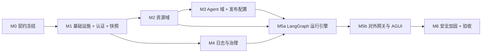

> **状态说明**：本文是历史设计基线。当前实现已移除前端 Mock/双模式、后端离线 stub、预置演示数据与「重置演示数据」功能；枚举、默认值与限额统一存放在数据库 `system_configs` 表。以 `README.md`、`backend/README.md` 与 `packages/contracts/openapi.json` 为准。

# albedo 后端实施计划

> 文档版本：v1.1
> 日期：2026-11-04
> 状态：分阶段实施基线
> 服务端技术栈：**Python 3.12 · FastAPI · LangGraph（LangChain 生态）**
> 配套文档：`docs/后端系统架构设计.md`、`docs/后端接口文档.md`
> 验收依据：`docs/智能体开发平台-产品文档.md` 第 12 章「产品验收总清单」

---

## 1. 前后端对接改造清单

### 1.1 总体策略

以「**页面零改动**」为目标：前端只新增 HTTP 适配层并替换 `frontend/src/mock/api.ts` 内部实现，页面组件、Zustand action、组件 props 与 `frontend/src/types/domain.ts` 类型基本不动。所有 `.tsx` 页面无需改写。

后端采用 Python 3.12 + FastAPI + LangGraph，前后端不再共享源码级类型包，改以 FastAPI 生成的 **OpenAPI 3.1 规范**为唯一契约源：Python 侧用 Pydantic v2 定义模型，前端由规范生成 TypeScript 类型与运行时校验 schema。契约变更须重新导出快照并由 CI 校验（见架构设计文档 3.2）。

前端工程现已整理至 `frontend/`，所有配置（`vite.config.ts` 的 alias、`tsconfig.json` 的 `baseUrl`/`paths`、`tailwind.config.js` 的 `content`、`index.html` 的 `/src/main.tsx`）均相对工程根目录解析，迁移后无需改动源码。

### 1.2 前端需改动的 6 处

| # | 文件 | 改动 |
|---|---|---|
| 1 | 新增 `frontend/src/lib/http.ts` | `fetch` 封装：`credentials:'include'`、注入 `requestId`、把 `{error:{code,message}}` 转成 `ApiError(code,message)`、统一超时与重试、CSRF Token 注入 |
| 2 | `frontend/src/mock/api.ts` | **保留导出名 `mockApi` 与全部方法签名 / 返回类型**，内部替换为 `http.ts` 调用；新增 `VITE_API_MODE=mock\|http` 开关，开发期可双模式回归 |
| 3 | `frontend/src/main.tsx` / `frontend/src/App.tsx` | 启动前 `GET /api/v1/workspace/bootstrap` → `useWorkspace.getState().replaceAll(data)`；401 则跳 `/login`；加载期间展示骨架屏 |
| 4 | `frontend/src/store/auth.ts` | 删除明文 Key 比对、`failedAttempts` / `lockedUntil` 本地计数；只保留 `authenticated`，由 `session` 接口与服务端 `429` 驱动 |
| 5 | `frontend/src/pages/LoginPage.tsx` | 去掉从 `settings.accessKey` 预填 / 比对，改为提交到 `auth.login`；演示 Key 由后端首启 seed 下发 |
| 6 | `frontend/vite.config.ts` | `server.proxy` 把 `/api` 与 `/v1` 代理到 `http://localhost:8000`（Uvicorn 默认端口），避免 CORS |

`README.md`（仓库根目录）同步更新运行命令为 `cd frontend && npm install && npm run dev`；后端本地启动为 `cd backend && uv run uvicorn app.main:app --reload --port 8000`，另起 `uv run arq app.worker.WorkerSettings` 处理后台任务。

### 1.3 三个易踩坑点

1. **测试会话消息渲染**：`frontend/src/pages/agents/TestChatPanel.tsx` 不消费 `SendResult.messages`，而是从 `chatSessions[agentId]` 读取。适配层拿到响应后必须调用 `appendChatMessages(agentId, messages)` 写回 store，否则 M5a 阶段界面不更新；M5b 引入 SSE 时，把增量事件聚合后同样写入 store。
2. **明文密钥不得进入 bootstrap**：`WorkspaceSettings.accessKey` 需从快照移除，仅保留 `accessKeySuffix`；`frontend/src/pages/settings/ChangeKeyDialog.tsx` 当前读取 `settings.accessKey` 做本地比对，改为完全依赖服务端校验。
3. **渐进迁移本地计算**：`frontend/src/mock/stats.ts` 与 `frontend/src/store/selectors.ts` 的统计 / 筛选在 bootstrap 全量快照下仍可工作，因此 M1～M3 阶段**不必修改**；到 M4 再把 `LogsPage` / `OverviewPage` 切到服务端分页与统计接口，避免一次性大改。

### 1.4 其他对接注意

- `settings.update` 的保留周期变更前端会即时调用一次，而「保存策略」按钮只弹 Toast，服务端需保证清理任务幂等。
- `logs.export` 前端现传整个 `filtered` 数组，需改为传 `filters` 对象，返回结构仍为 `ExportTask`。
- `models.create` 的 `tested` 参数由服务端连接测试记录取代，前端可保留该参数但被忽略。
- `settings.domain` 由后端下发，保证发布页 Endpoint 与真实网关一致。
- 时间统一 UTC 存储，按 `settings.timezone` 渲染；前端 `isToday` 逻辑需按工作区时区计算。
- 所有 ID 由服务端生成，前缀规则不变；前端 `frontend/src/lib/id.ts` 在 `http` 模式下不再参与业务实体 ID 分配。
- 契约生成脚本纳入 M0 并接入 CI：FastAPI 路由变更未重新导出 `openapi.json` 时构建失败。

---

## 2. 里程碑依赖关系

M2 与 M4 可在 M1 后并行（不同服务模块、不同数据表）；M5a → M5b 是唯一强串行关键路径，建议预留最大工作量与联调缓冲。

---

## 3. 里程碑详表

### M0 · 契约冻结

| 项 | 内容 |
|---|---|
| 目标 | 锁定前后端契约，不改变任何业务行为 |
| 交付物 | FastAPI 自动导出的 OpenAPI 3.1 规范；`packages/contracts/openapi.json` 契约快照 + `openapi-typescript` / Zod 生成脚本；Pydantic v2 请求 / 响应模型；`frontend/src/lib/http.ts`；Vite proxy（8000 端口）；`VITE_API_MODE` 双模式开关；schemathesis 契约测试骨架 |
| 依赖 | 无 |
| 前端可验证点 | `cd frontend && npm run typecheck` 通过；`mock` 模式全量回归与现状无差异 |

### M1 · 基础设施 + 认证 + 快照

| 项 | 内容 |
|---|---|
| 目标 | 服务端可启动，前端整体数据来自后端 |
| 交付物 | Python 3.12 + `uv.lock`；FastAPI / Uvicorn 应用骨架；SQLAlchemy 2.0 模型与 Alembic 迁移；seed 导入（附录 B 全部 12 类实体）；MySQL / Redis 异步接入；会话中间件 + `hmac.compare_digest` 恒定时间鉴权 + Redis 限流；`auth/*` 三个接口；`GET /api/v1/workspace/bootstrap`；structlog + `contextvars`（`requestId`）；ARQ worker 骨架 |
| 依赖 | M0 |
| 前端可验证点 | 切 `http` 模式后登录、10 个路由、刷新保留全部正常；退出登录清除会话；连续失败 5 次触发 30 秒限流 |

### M2 · 资源域

| 项 | 内容 |
|---|---|
| 目标 | 四类资源真实 CRUD、连接测试与引用分析 |
| 交付物 | 凭证保险库（`argon2-cffi` + `cryptography` Fernet）；Model / MCP / Skill / BuiltinTool 服务；`models/test` 用 `ChatOpenAI` 按类型发起最小请求；`mcps/test` 用 `langchain-mcp-adapters.MultiServerMCPClient` 完成 SSE / Streamable HTTP / stdio 握手与工具发现；multipart Skill 上传与内容校验；`resources/:kind/:id/impact`；工具启停与额度；`httpx` DNS 解析后 IP 白名单防 SSRF |
| 依赖 | M1 |
| 前端可验证点 | 接入弹窗测试连接返回真实延迟与错误分类；停用时弹窗显示受影响 Agent 清单；Skill 上传新版本保留历史包 |

### M3 · Agent 域 + 发布配置

| 项 | 内容 |
|---|---|
| 目标 | 配置与发布状态服务端化 |
| 交付物 | Agent CRUD + 乐观锁 + `config_snapshot`；`ChatPromptTemplate(template_format="jinja2")` 变量解析与缺失值校验；发布前检查；双协议独立开关；凭证签发 / 重置；模型多版本发布、唯一性校验、Key 轮换；`history` 按不可变 `agentId` + 结构化 `source` 关联 |
| 依赖 | M1、M2（引用分析） |
| 前端可验证点 | 编辑器保存刷新生效；AGUI 开启同步置为已发布；发布弹窗冲突提示与前端文案一致；对话历史筛选正确 |

### M4 · 日志与治理

| 项 | 内容 |
|---|---|
| 目标 | 统一可观测与统计口径 |
| 交付物 | `LogService` 写入管线 + 脱敏；`GET /api/v1/logs` 服务端分页 / 筛选 / 执行链路；导出异步任务 + 签名下载；`stats/*`、`search`、`notifications`；保留清理与归档任务（ARQ cron）；`settings/*` 与 `reset-demo` |
| 依赖 | M1（可与 M2 并行） |
| 前端可验证点 | 概览与日志指标一致；日志分页 / 类型计数 / 链路正确；导出任务可轮询下载；改保留周期后清理可审计；通知「全部已读」刷新后保持 |

### M5a · LangGraph 运行引擎（非流式）

| 项 | 内容 |
|---|---|
| 目标 | 测试会话真实化，替换 `frontend/src/mock/runtime.ts` |
| 交付物 | 基于 LangGraph `StateGraph` 的 `RuntimeEngine`（`prepare → model → 条件边 → tools → finalize`）；冻结配置快照、Jinja2 变量注入与 `{{currentTime}}`、checkpointer 实现 `keepContext`、`with_retry` 实现 `autoRetry`、回调产出思考摘要、工具调用计数 / `maxToolCalls` / `maxRunSeconds` 终止；LangChain `init_chat_model` / `ChatOpenAI` 模型适配；`ToolNode`（MCP Adapter + `StructuredTool` 注册表 + Skill 加载器 + 内置工具沙箱）；`POST /api/v1/agents/:id/test-runs` 返回 `SendResult` |
| 依赖 | M2、M3、M4 |
| 前端可验证点 | 测试会话产生真实回复与工具消息；日志页可按 `runId` 展开完整链路；触顶写 `finishReason: tool_limit`；缺失变量返回可读错误 |

### M5b · 对外网关（流式）

| 项 | 内容 |
|---|---|
| 目标 | 发布接口真实可调用 |
| 交付物 | `POST /v1/agents/:id/chat`（JSON + SSE）；`POST /api/agui/v1/.../run`（LangGraph `astream_events` → AGUI 事件适配器、`sequence` 单调递增、`Last-Event-ID` 续传）；`/v1/chat/completions`、`/v1/embeddings`、`/v1/models` 用 `httpx` 独立透传（不经 LangGraph）；Bearer 鉴权路由 7 步 + Redis Lua 令牌桶 QPM + Header / 参数合并 |
| 依赖 | M5a |
| 前端可验证点 | 用发布页示例（curl / Python / JavaScript）实际调通；重置凭证后旧 Key 失效；停用版本返回明确错误；AGUI 事件顺序符合协议 |

### M6 · 安全加固与验收

| 项 | 内容 |
|---|---|
| 目标 | 达到产品文档第 12 章验收清单 |
| 交付物 | SSRF 白名单、Docker / gVisor 沙箱隔离（禁用 `PythonREPLTool`）、文件病毒 / Zip Bomb 检查、XSS 清理、密钥脱敏审计、并发保存冲突测试、备份与恢复、性能压测、全量验收报告 |
| 依赖 | M5b |
| 前端可验证点 | 逐项对照第 12 章勾选；桌面 / 平板 / 移动端主流程可完成；首屏 <2s、SSE 首事件 <2s |

---

## 4. 分阶段迁移策略

采用「**先快照、后分片**」的渐进路径，避免一次性重构导致前端大面积改动：

1. **M1 阶段**：bootstrap 返回完整 `WorkspaceData`，前端仍用 `computeStats` / `filterLogs` / `globalSearch` 等本地派生逻辑，页面完全不改。
2. **M4 阶段**：日志数据量增长后，bootstrap 内 `logs` 退化为「最近活动 5 条 + 统计摘要」，`LogsPage` 与 `OverviewPage` 切换到服务端分页与统计接口。
3. **M5 阶段**：`chat.send` 先保持一次性 `SendResult`（M5a），再升级为 SSE 增量（M5b）；适配层统一把消息写回 `chatSessions`，页面渲染逻辑不变。

`VITE_API_MODE=mock|http` 开关在 M6 验收前保留，确保任何阶段都能回退到纯前端演示态做对比回归。

---

## 5. 验收标准

对照 `docs/智能体开发平台-产品文档.md` 第 12 章，后端联调后需逐项满足：

| 组 | 关键验收项 |
|---|---|
| 登录与全局框架 | 未登录不能访问受保护数据接口；登录成功 / 退出 / 限流流程正确；全局搜索可定位 Agent 与模型；通知已读持久化 |
| 概览 | 指标与各管理页统计口径一致（服务端单一数据源）；趋势按自然日聚合；「全部正常」随异常联动 |
| Agent | 创建 / 搜索 / 筛选 / 编辑 / 保存生效；Prompt 变量、模型参数、挂载与高级设置持久化；LangGraph 条件边在 `maxToolCalls` / `maxRunSeconds` 下正确终止；对话历史按 `agentId` + `source` 关联；双协议独立开关；凭证脱敏与重置 |
| 能力资源 | MCP 可接入、测试、发现 Tool、配置额度并启停；Skill 安全上传、校验、版本化与挂载；内置工具全局启停影响正确；资源停用影响可见且可恢复 |
| 模型 | 接入、测试、备注、编辑、启停；资源配置无默认温度；同一模型多版本发布；版本独立调用标识 / Key / Header / 参数 / QPM / 启停 |
| 日志与设置 | 六类日志组合筛选、服务端分页、按真实时间的执行链路；异步导出且脱敏；敏感信息在列表 / 详情 / 导出中均脱敏；设置持久化；清理与归档可审计；重置演示数据二次确认 |
| 非功能 | 首屏 2 秒内可交互；搜索 300ms 防抖下反馈 <500ms；SSE 首事件 <2s；服务重启后配置、发布状态与日志不丢失；上游异常不导致配置损坏 |

---

## 6. 风险与应对

| 风险 | 影响 | 应对 |
|---|---|---|
| 前端把全量快照当本地 store，日志增长后 bootstrap 膨胀 | 首屏变慢、内存占用高 | bootstrap 只返回最近 N 条日志 + 聚合统计；M4 起日志走独立分页接口 |
| SSE 与前端现有一致性返回模型不匹配 | 测试会话界面不更新 | M5a 先保持一次性 `SendResult`，M5b 才引入增量；适配层统一写回 `chatSessions` |
| 五类凭证混淆或明文泄露 | 安全事故 | 独立 `credentials` 表按 `type` 隔离，仅 hash + suffix 可读；bootstrap 剔除明文；所有日志 / 导出走统一脱敏管线 |
| 对外面被管理面鉴权中间件误伤 | 发布接口 401/403 | Nginx 前缀精确路由 + 两套依赖注入链，集成测试覆盖跨面错误 |
| 连接测试 / 工具发现超时阻塞请求 | 页面卡死 | ARQ 异步执行 + `asyncio.wait_for` 超时控制，前端展示阶段性状态；超过 10 秒可取消 |
| LangChain / LangGraph 版本迭代快、API 漂移 | 升级返工 | `uv.lock` 锁定版本；模型与工具适配收敛到 `ModelGateway` / `ToolGateway` 薄封装层；AGUI 事件适配器与框架事件解耦，升级只改映射表 |
| 误用 LangChain 内置执行工具导致 RCE | 主机失陷 | 禁用 `PythonREPLTool` 等可直接执行代码的内置工具；`code_interpreter` 自研 `StructuredTool` 且强制容器沙箱 |
| 个人部署运维成本过高 | 落地困难 | 模块化单体 + 现有 MySQL / Redis + Docker Compose（`nginx + backend + arq-worker + redis`）一键启动；沙箱提供最小隔离降级档 |
| 多标签页并发保存覆盖 | 配置丢失 | `agents.version` 乐观锁 + `409 stale_version`，前端提示刷新或比较 |
| Skill / stdio 脚本越权 | 主机失陷 | 强制沙箱、路径穿越与 Zip Bomb 检查、最小权限文件系统；禁止任意 Shell 注入 |

---

## 7. 交付物清单

| 阶段 | 代码 / 配置 | 文档 / 测试 |
|---|---|---|
| M0 | `packages/contracts/openapi.json`、Pydantic v2 模型与生成脚本、`frontend/src/lib/http.ts`、Vite proxy（8000） | OpenAPI 3.1、schemathesis 契约测试 |
| M1 | `backend/` FastAPI 骨架、`uv.lock`、SQLAlchemy 2.0 模型与 Alembic 迁移、seed、认证模块、ARQ worker | 部署说明、登录集成测试 |
| M2 | 四个资源模块、凭证保险库、LangChain 模型适配与 MCP 工具发现、SSRF 白名单、沙箱 | 资源域单测、SSRF 用例 |
| M3 | Agent 与发布模块、Jinja2 变量校验、`config_snapshot`、乐观锁 | 发布前检查用例、并发保存用例 |
| M4 | 日志、统计、通知、设置、导出与 ARQ cron 清理任务 | 链路追踪测试、导出脱敏测试 |
| M5 | LangGraph `StateGraph` 运行引擎、AGUI 事件适配器、`httpx` 模型发布网关、SSE 端点 | 协议一致性测试（AGUI 事件顺序）、SDK 集成示例 |
| M6 | 安全加固、监控与备份 | 全量验收报告、性能压测报告、运维手册 |
