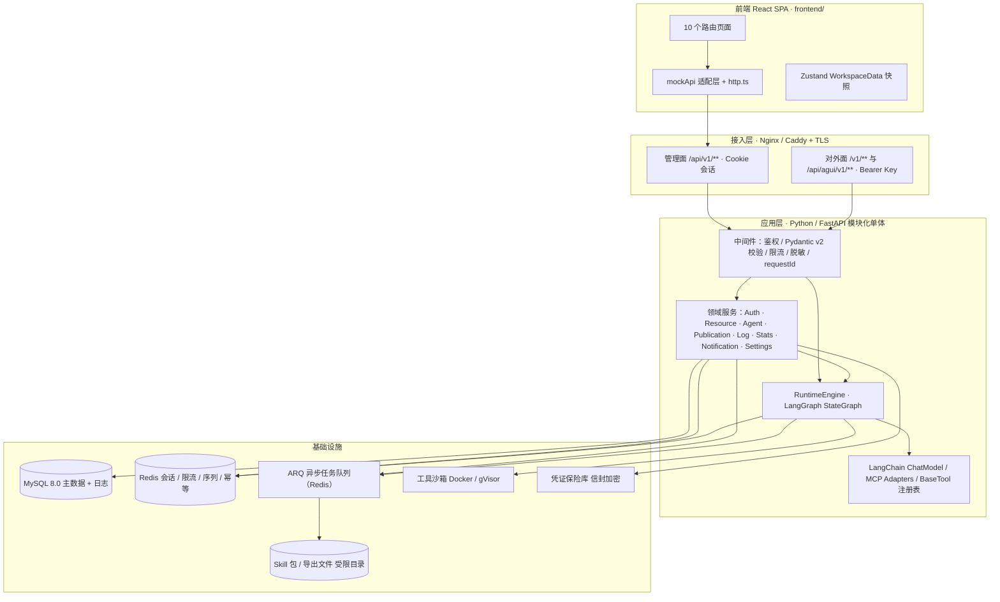
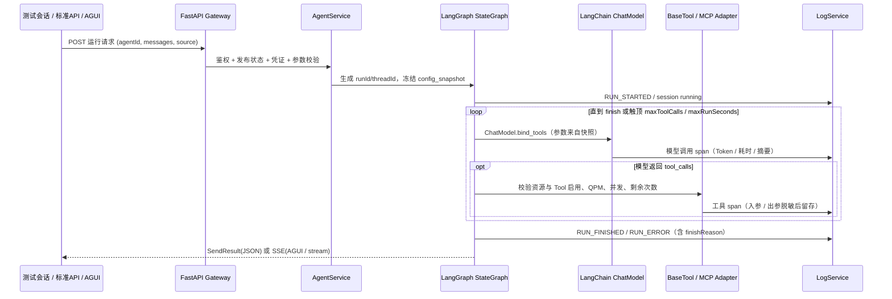

> **状态说明**：本文是历史设计基线。当前实现已移除前端 Mock/双模式、后端离线 stub、预置演示数据与「重置演示数据」功能；枚举、默认值与限额统一存放在数据库 `system_configs` 表。以 `README.md`、`backend/README.md` 与 `packages/contracts/openapi.json` 为准。

# albedo 配套后端系统架构设计

> 文档版本：v1.1
> 日期：2026-11-04
> 状态：设计基线，供研发评审与实施
> 服务端技术栈：**Python 3.12 · FastAPI · LangGraph（LangChain 生态）**
> 依据：`docs/智能体开发平台-产品文档.md`（第 3、4、6、7、10、12 章）与当前前端实现 `frontend/src/`
> 配套文档：`docs/后端接口文档.md`、`docs/后端实施计划.md`

---

## 1. 设计目标与对接基线

### 1.1 前端现状（契约来源）

| 前端现状 | 位置（迁移后） | 对后端的约束 |
|---|---|---|
| 唯一写边界：`mockApi.*` 的 26 个 Promise 命令 | `frontend/src/mock/api.ts` | 保留全部方法名与返回类型，仅替换内部实现 |
| 唯一读边界：`WorkspaceData` 全量快照（12 类实体） | `frontend/src/store/workspace.ts`、`frontend/src/types/domain.ts` | 提供 `GET /api/v1/workspace/bootstrap` 返回同构快照 |
| 错误只展示 `.message`，不读 `.code` | `frontend/src/mock/errors.ts`、16 个页面的 `asError()` | 统一错误体 `{error:{code,message,requestId}}`，适配层转 `ApiError(code,message)` |
| 登录为本地 `authenticated` 布尔 + 明文 Key 比对 | `frontend/src/store/auth.ts`、`frontend/src/pages/LoginPage.tsx` | 改 HttpOnly Cookie 会话，限流移入 Redis，bootstrap 不下发明文 Key |
| 统计 / 筛选 / ID / 日志 / 导出 / 运行均本地计算 | `frontend/src/mock/stats.ts`、`frontend/src/store/selectors.ts`、`frontend/src/lib/export.ts`、`frontend/src/mock/runtime.ts` | 分阶段迁至服务端，字段名与枚举保持不变 |
| 发布页展示的对外地址 | `frontend/src/components/common/CodeSample.tsx` | 网关路径必须与前端展示逐字一致，`settings.domain` 由后端下发 |

### 1.2 设计目标

1. **页面零改动**：前端只新增 `frontend/src/lib/http.ts` 适配层并替换 `mockApi` 内部实现，组件、Zustand action、props 与 `domain.ts` 类型基本不动。
2. **单一数据源**：所有实体、配置快照与日志由服务端持久化，取消 `localStorage` 作为业务数据源。
3. **两套能力输出**：管理面（Cookie 会话）与对外面（Bearer 凭证）严格隔离，互不复用鉴权、限流与错误码。
4. **可观测可追溯**：任意一次运行都能用 `runId` 串起模型、MCP、Skill、内置工具与会话日志。
5. **AI 生态优先**：采用 Python 3.12 + LangChain / LangGraph，直接复用 OpenAI 兼容模型适配、MCP 工具协议、流式事件与 Agent 循环编排，避免自研编排引擎。
6. **个人部署友好**：模块化单体 + MySQL + Redis + 一个后台 worker，Docker Compose 一键启动，不引入多租户、微服务与网关集群。

### 1.3 总原则

后端所有响应字段严格复用 `frontend/src/types/domain.ts` 的命名与枚举值；ID 前缀、状态语义、时间格式、脱敏口径与产品文档第 2.3、2.4、10.1 节一致。前后端不再共享源码级类型包，改以 FastAPI 生成的 **OpenAPI 3.1 规范**为唯一契约源（见 3.2）。

---

## 2. 总体架构

### 2.1 分层结构



层间规则：

- **表现层**（`frontend/`）不直接访问数据库，只通过 `http.ts` 访问管理面 API。
- **接入层**负责 TLS 终止、前缀路由、请求体大小限制与慢速攻击防护。
- **应用层**采用 Python 模块化单体：按领域划分 service 模块，共享 FastAPI 依赖注入与事务边界；LangGraph 作为独立运行引擎模块被 Agent 服务调用。
- **基础设施层**通过 Repository 接口访问，便于 pytest 中用测试替身替换。

### 2.2 两套 API 平面的隔离

| 维度 | 管理面 `/api/v1/**` | 对外面 `/v1/**`、`/api/agui/v1/**` |
|---|---|---|
| 调用方 | 个人用户的管理界面 | 下游系统、脚本、Agent 对话前端、OpenAI SDK |
| 认证 | HttpOnly / Secure / SameSite Cookie + CSRF Token | `Authorization: Bearer <Key>` |
| 授权粒度 | 整个个人工作区 | 单个 Agent 或单个模型发布版本 |
| 限流 | 登录失败 5 次 / 30 秒 | 版本级 QPM 令牌桶、MCP 调用额度 |
| 错误码集合 | 内部 `ApiError` 体系 | 产品文档第 3.1.3 / 3.5.4 对外错误码 |
| 日志 `source` | `system` / `test_session` | `standard_api` / `agui` / `model_api` |

Nginx 需按前缀精确匹配 `/api/v1/` 与 `/api/agui/v1/`，避免与对外 `/v1/` 冲突；两条依赖注入链与中间件完全独立，集成测试覆盖跨面 401/403。

### 2.3 仓库布局（与本次目录整理对齐）

```
albedo/
├── frontend/            # 现有 React 前端工程（全部工程文件与 src/）
├── backend/             # 规划中：Python 3.12 + FastAPI + LangGraph 后端服务
├── packages/contracts/  # 规划中：OpenAPI 3.1 契约快照 + 前端类型生成脚本
├── docs/                # 产品文档、原型截图、本套后端设计文档
└── README.md            # 仓库总览与导航
```

Python 侧用 Pydantic v2 定义请求 / 响应模型，FastAPI 自动导出 OpenAPI 3.1；前端由该规范生成 TypeScript 类型与运行时校验 schema。**契约的唯一事实来源是 OpenAPI 规范**，而不是共享源码包，避免 Python / TypeScript 类型互相牵制。生成链路见 3.2。

---

## 3. 核心组件选型

| 层 | 选型 | 理由 |
|---|---|---|
| 运行时 | **Python 3.12** + `uv`（依赖锁定） | AI / Agent 生态最完整；`uv` 秒级安装与可复现锁文件；单机可部署 |
| Web 框架 | **FastAPI** + Uvicorn（生产可加 Gunicorn `UvicornWorker`）+ `sse-starlette` | 原生 async、自动生成 OpenAPI 3.1、`EventSourceResponse` 支持 SSE 与 `Last-Event-ID` 断线恢复 |
| 数据校验 | **Pydantic v2** + `pydantic-settings` | 请求 / 响应 / 配置统一模型；规则与 `frontend/src/lib/validate.ts` 对齐（名称 1–50、变量名、JSON 对象 Header、温度 0–2、工具次数 1–100），前后端双重校验 |
| Agent 编排 | **LangGraph**（`StateGraph` + checkpointer + 条件边） | 天然表达「模型 → 工具 → 再推理」循环、触顶 / 超时终止、可中断与状态快照，正好映射产品文档的 Run 生命周期与高级设置 |
| 模型接入 | **LangChain** `init_chat_model` / `ChatOpenAI` | 统一封装任意 OpenAI 兼容上游（OpenAI / Azure / DeepSeek / 通义 / vLLM / Ollama），只需切换 `base_url` + `model` + `api_key`；工具调用走统一 `tool_calls` 协议 |
| 工具生态 | `langchain-mcp-adapters`（`MultiServerMCPClient`）+ `mcp` Python SDK | 把 SSE / Streamable HTTP / stdio 三类 MCP server 的 Tool 直接转成 LangChain `BaseTool`，工具发现与输入 Schema 免自研 |
| 提示词 | `ChatPromptTemplate(template_format="jinja2")` | Jinja2 的 `{{var}}` 与产品文档双花括号变量语法天然一致；`{{currentTime}}` 系统变量用 `partial_variables` 注入，缺失必需变量在入图前由 Pydantic 拦截 |
| ORM / 迁移 | **SQLAlchemy 2.0（async）** + Alembic + `asyncmy` | 复用 `docs/运维信息.md` 已提供的 MySQL 8.0；迁移可版本化；`config_snapshot` 等用 `JSON` 列 |
| 缓存 / 限流 | `redis-py` asyncio + Lua 原子令牌桶 | 会话、版本级 QPM、MCP 并发信号量、`runId` 幂等、SSE `sequence` 游标与断线恢复 |
| 异步任务 | **ARQ**（Redis 队列，支持 cron） | 连接测试、工具发现、日志导出、每日保留清理与健康检查；与全异步栈一致、部署轻（团队已熟悉 Celery 时可平替） |
| HTTP 客户端 | `httpx` AsyncClient（流式透传） | 模型发布网关转发与上游连通性测试；自定义 transport 在 DNS 解析后校验 IP 白名单，阻断 SSRF |
| 日志 | **structlog** + `contextvars` | JSON 结构化输出，自动注入 `requestId` / `runId` / `threadId`；字段与 `LogEntry` 一一对应，写入前统一脱敏 |
| 密钥 | `cryptography` Fernet（信封加密）+ `argon2-cffi` | 五类凭证只存 Argon2id hash + 密文 + 后缀，主密钥由环境变量注入 |
| 文件校验 | `zipfile` + `python-magic` + 自定义校验器 | 扩展名、100 MB、解压体积 / 数量 / 深度、`../` 穿越、符号链接、Zip Bomb 与 manifest 检查 |
| 沙箱 | Docker / gVisor 容器 | stdio MCP、Skill 脚本、代码执行器最小权限运行；**禁止直接使用 LangChain `PythonREPLTool`** |
| 测试 | pytest + pytest-asyncio + `httpx.ASGITransport` + **schemathesis** + testcontainers-python | 基于 OpenAPI 的契约测试、AGUI 事件顺序测试，复用前端 seed 数据做集成用例 |

凭据一律通过环境变量注入（连接信息见 `docs/运维信息.md`），**明文不得写入仓库、方案文档或日志**。

### 3.1 LangGraph 运行引擎设计

运行引擎是 Python 技术栈的核心价值点：产品文档第 4.1 节的 Agent 单次运行时序，可直接映射为一张 LangGraph `StateGraph`，无需自研循环与状态机。

**图结构**：

```
START → [prepare]  冻结 config_snapshot、注入系统/请求变量、初始化 tool_call_count
      → [model]    LangChain ChatModel（bind_tools，tool_choice=auto）
      → 条件边 should_continue
           ├─ 有 tool_calls 且未触顶且未超时 → [tools] ToolNode（MCP / Skill / 内置工具）→ [model]
           └─ 否则 → [finalize] 汇总 usage / finishReason / 耗时 → END
```

`AgentState`（`TypedDict`）：`messages: list[BaseMessage]`、`thread_id`、`run_id`、`tool_call_count`、`started_at`、`finish_reason`、`usage`、`state_delta`。

**业务规则 → 框架能力映射**：

| 产品文档规则 | LangGraph / LangChain 实现 |
|---|---|
| 配置快照冻结（4.3） | 每次 Run 把 `config_snapshot` 作为 `RunnableConfig.configurable` 传入，运行中不重新读库 |
| 保留会话上下文 `keepContext`（3.1.2.7） | `AsyncRedisSaver` checkpointer 按 `thread_id` 复用；关闭时每次新建 thread |
| 变量 `{{var}}` / `{{currentTime}}` | `ChatPromptTemplate(template_format="jinja2")` + `partial_variables`；入图前 Pydantic 校验缺失变量并返回 `422 missing_variable` |
| 自动重试 `autoRetry` | `Runnable.with_retry()` 仅对超时 / 5xx 等临时错误生效；鉴权失败、参数错误直接抛出 |
| 输出思考摘要 `outputThinkingSummary` | 自定义 `BaseCallbackHandler` 产出阶段性摘要，不输出模型私有推理链 |
| 最大工具调用次数 `maxToolCalls` | 条件边读取 `state.tool_call_count`；达到上限直接跳 `[finalize]` 并写 `finish_reason: tool_limit` |
| 单次运行最大时长 `maxRunSeconds` | `asyncio.wait_for` 包裹 `astream_events`，超时取消图执行并写 `RUN_ERROR` / `run_timeout` |
| MCP / Skill / 内置工具统一工具化 | `MultiServerMCPClient` + `StructuredTool` 注册表生成 `ToolNode`；执行前统一校验启用状态、QPM 与并发 |
| 每次实际请求计 1 次（含重试） | 工具 wrapper 内递增 `tool_call_count` 并写 span 日志 |
| 资源停用立即阻断后续调用 | 工具 wrapper 在 `async with` 构造 `ToolNode` 时按启用状态动态过滤，已挂载但停用的资源不进入工具列表 |

**AGUI 事件映射**（LangGraph `astream_events(version="v2")` → AGUI SSE）：

| LangGraph 事件 | AGUI 事件 |
|---|---|
| `on_chain_start`（graph 根） | `RUN_STARTED` |
| `on_chat_model_stream` 首片 | `TEXT_MESSAGE_START` |
| `on_chat_model_stream` 增量 | `TEXT_MESSAGE_CONTENT(delta)` |
| `on_chat_model_end` | `TEXT_MESSAGE_END` |
| `on_tool_start` | `TOOL_CALL_START` + `TOOL_CALL_ARGS` |
| `on_tool_end` | `TOOL_CALL_END` + `TOOL_CALL_RESULT` |
| `astream(..., stream_mode="custom")` | `STATE_SNAPSHOT` / `STATE_DELTA` |
| `on_chain_end`（graph 根） | `RUN_FINISHED` |
| 异常 / 超时 | `RUN_ERROR`（含 `retryable`） |

`sequence` 由服务端单调递增生成器分配并写入 Redis，配合 `Last-Event-ID` 续传；工具结果默认只下发安全摘要，完整值在权限允许时由日志详情查看。标准对话 API 的非流式响应由 `[finalize]` 节点直接组装为 `agent.chat.completion` 结构。

**边界说明**：模型对外发布接口（`/v1/chat/completions`、`/v1/embeddings`）**不经过 LangGraph**，由独立 FastAPI 路由用 `httpx` 做 OpenAI 兼容流式透传，以保证 SDK 兼容性、参数优先级与版本级 QPM 控制；只有 Agent 测试会话、标准对话 API 与 AGUI 走 LangGraph 引擎。

### 3.2 契约生成链路

```
Pydantic v2 模型（backend/app/schemas/）
  → FastAPI 自动生成 OpenAPI 3.1（GET /openapi.json）
  → packages/contracts/openapi.json（契约快照，纳入版本管理）
  → openapi-typescript 生成 frontend/src/types/generated.ts
  → zod-openapi / @hey-api 生成前端运行时校验 schema
```

前端现有 `frontend/src/types/domain.ts` 在生成类型稳定后逐步替换，字段名与枚举保持不变，因此「页面零改动」目标不变。后端每次接口变更需重新导出契约快照，CI 用 schemathesis 校验实现与规范一致。

---

## 4. 数据模型

### 4.1 核心表

| 表 | 主要字段 | 说明 |
|---|---|---|
| `workspace_settings` | workspace_name, language, timezone, domain, telemetry, auto_archive, retention_days, access_key_suffix | 单用户单条记录 |
| `credentials` | id, type, hash, cipher, suffix, resource_id, rotated_at | 五类凭证隔离，只存 Argon2id hash + 加密密文 + 后缀 |
| `sessions` | id, user_id, created_at, idle_expires_at, absolute_expires_at | 不透明会话 ID，服务端可撤销 |
| `agents` | id, name, description, theme, default_model_id, test_model_id, system_prompt, variables, model_params, advanced, api_enabled, agui_enabled, credential_suffix, session_count, version, timestamps | 对应 `Agent` |
| `agent_mounts` | agent_id, kind, resource_id, skill_version | 只存内部 ID，联合唯一防重复挂载 |
| `models` | id, name, upstream_model_id, type, vendor, base_url, credential_suffix, headers_enc, timeout_seconds, note, enabled, connection, latency_ms, last_tested_at | 对应 `ModelResource`；不设资源级默认温度 |
| `model_publications` | id, model_id, version, call_identifier, credential_suffix, headers_enc, temperature, max_output_tokens, qpm, enabled, created_at | 对应 `ModelPublication` |
| `mcp_servers` / `mcp_tools` | transport, endpoint, headers_enc, timeout_seconds, qpm, max_concurrency, connection / key, name, description, enabled | Tool Key 同 MCP 内唯一 |
| `skills` / `skill_versions` | name, instructions, verified, size_bytes / version, file_path, manifest | 资源与版本分离，历史包保留 |
| `builtin_tools` | id, key, name, description, version, enabled, call_count | 代码注册表，管理界面只读状态 |
| `runs` | run_id, thread_id, agent_id, source, status, config_snapshot, finish_reason, usage, duration_ms, timestamps | 配置快照冻结，保证历史可解释 |
| `chat_messages` | id, thread_id, run_id, agent_id, role, content, tool_call, timestamp | 对应 `ChatMessage` |
| `log_entries` | log_id, timestamp, type, status, source, name, summary, run_id, thread_id, agent_id, resource_id, duration_ms, input_summary, output_summary, token_usage, error_code, error_message, credential_suffix | 对应 `LogEntry`，UTC 存储按月分区 |
| `export_tasks` | id, format, filters_json, record_count, file_size_bytes, expires_at, status, file_path | 异步导出任务 |
| `notifications` | id, kind, title, summary, timestamp, target_path, read | 未读数持久化 |
| `trend_daily` | date, call_count, success_count, total_duration_ms | 每日聚合，支撑 14/30 天趋势 |

SQLAlchemy 2.0 声明式模型 + Alembic 迁移；`config_snapshot`、`model_params`、`advanced`、`variables` 使用 MySQL `JSON` 列并配 Pydantic 校验，避免无 schema 的自由字典。

### 4.2 关键约束

- `credentials.type` 枚举：`management_access_key` / `upstream_model_key` / `model_publication_key` / `agent_token` / `mcp_auth_header`，互不复用存储字段。
- `model_publications.call_identifier` 全库唯一（**含已停用版本**）；`(model_id, version)` 联合唯一。
- `agent_mounts` 只存资源 ID；资源停用不改挂载关系，恢复后引用自动可用。
- `runs.config_snapshot` 冻结 Prompt、变量、模型、生成参数、挂载与高级限制；运行途中保存的新配置只影响后续 Run。
- `agents.version` 乐观并发锁（`If-Match` / `expectedVersion`），多标签页编辑冲突时返回 `409 stale_version`。
- `log_entries` 建 `(run_id, timestamp)` 联合索引；`input_summary` / `output_summary` 写入前经统一脱敏管线。
- ID 前缀严格沿用产品文档 10.1：`agt-` / `mdl-` / `pub-` / `mcp-` / `skill-` / `tool-` / `run_` / `thd_` / `log-` / `exp-`，全部由服务端生成。

---

## 5. 数据流向

### 5.1 管理端写（创建 / 编辑 / 启停 / 发布）

```
页面 → mockApi.xxx() → http.ts(fetch, credentials:include)
  → POST/PATCH /api/v1/... → 会话鉴权 → Pydantic v2 校验 → 领域服务
  → MySQL 事务（实体 + 系统操作日志 + version+1）→ Redis 缓存失效
  → 返回实体 / 一次性明文密钥 → 适配层写回 Zustand → Toast
```

多资源保存采用单事务（`async with session.begin()`），禁止只写入部分挂载关系；写操作统一产生一条 `type=system` 的审计日志。

### 5.2 Agent 单次运行（测试会话 / 标准 API / AGUI 共用一条 LangGraph）



运行时规则（对齐产品文档 3.1.2.7、4.1）：

- 变量解析顺序：系统变量（`{{currentTime}}`）→ 请求变量 → 缺失值校验，缺失必需变量返回 `422 missing_variable`，不把原始占位符发给模型。
- 每次实际工具请求计 1 次（含自动重试），触顶写入 `finishReason: tool_limit` 并提示「已达到最大工具调用次数」。
- `source` 由入口结构化写入（`test_session` / `standard_api` / `agui` / `model_api` / `system`），**禁止**按名称或 `runId` 前缀推断。
- AGUI 事件由 3.1 节的 `astream_events` 适配器产出，严格 `RUN_STARTED` 首发、`START→CONTENT→END` 配对、工具调用 `START→ARGS→END→RESULT`、`sequence` 单调递增、单 Run 仅一个终止事件，支持 `Last-Event-ID` 续传。
- 工具结果默认只下发安全摘要，完整值在权限允许时由日志详情查看。

### 5.3 模型对外发布 API（鉴权路由顺序）

1. 解析 Bearer Token，定位其授权的发布版本。
2. 校验请求 `model` 等于该版本 `callIdentifier`。
3. 校验发布版本与模型资源均处于启用状态。
4. 执行版本级 QPM 令牌桶限流（流式连接建立时计一次）。
5. 合并参数：平台安全上限 > 发布版本配置 > 下游请求（温度允许覆盖但受 0–2 限制，最大输出 Tokens 只许更小，QPM 不可覆盖）。
6. 合并 Header：平台固定头优先且不可覆盖，禁止 `Host` / `Content-Length` / 连接控制类头。
7. 用 `httpx.AsyncClient.stream()` 映射上游真实 Model ID 后转发，流式透传或组装响应，写 `model_api` 日志（仅记录 Key 后缀）。

该链路不经过 LangGraph，理由见 3.1 边界说明。

### 5.4 日志与治理流

所有路径 → `LogService`（structlog + 脱敏管线）→ MySQL 在线索引 → ARQ 每日 cron 清理任务按 `retention_days` 执行（`autoArchive` 开启时先压缩归档）→ 导出任务异步生成 CSV/JSON 并写审计日志。清理与导出均生成 `type=system` 记录，可审计；清理后对话历史不再可见被清理的执行详情。

---

## 6. 安全与可观测设计

| 维度 | 实现 |
|---|---|
| 凭据 | `argon2-cffi` Argon2id hash + `cryptography` Fernet 信封加密；五类凭证隔离；完整值在创建 / 重置 / 轮换响应返回，并可由管理面专用查看端点按需解密（登录态、`no-store`、审计留痕）；日志、导出、埋点、错误上报均不含明文 |
| 会话 | 不透明 ID + HttpOnly / Secure / SameSite Cookie；空闲 2h、绝对 24h；退出立即撤销；修改访问 Key 后其他会话失效 |
| 登录 | `hmac.compare_digest` 恒定时间比对；Redis 失败计数（5 次锁 30 秒）；成功 / 失败 / 限流全写 `system` 日志 |
| 输入 | Pydantic v2 双重校验；URL 仅 HTTP(S)；Header 必须为 JSON 对象；文件类型、大小、解压体积、路径穿越、符号链接、Zip Bomb 检查 |
| 出站 | `httpx` 自定义 transport 在 DNS 解析后校验 IP 白名单，阻断云元数据地址、回环与未授权内网；`stdio` MCP / Skill 脚本 / 代码执行器在沙箱运行，禁用 `PythonREPLTool` |
| 输出 | Markdown / 富文本 XSS 清理；工具结果默认摘要化 |
| 可观测 | `runId` 全链路关联；structlog + `contextvars` 自动注入 `requestId` / `runId` / `threadId`；LangChain Callback 采集模型与工具 span；每日趋势聚合表 |

---

## 7. 部署形态

个人单用户版本采用单机部署：

- `frontend/` 构建为静态资源，由 Nginx 托管。
- `backend/` 由 Uvicorn 运行 FastAPI 应用（生产可加 Gunicorn `UvicornWorker`），`systemd` / supervisor 守护；ARQ worker 作为独立进程处理后台任务与每日 cron。
- MySQL 8.0 与 Redis 复用 `docs/运维信息.md` 已提供实例，凭据经环境变量注入；依赖用 `uv.lock` 锁定。
- 工具沙箱为唯一较重依赖；个人本地部署提供「容器隔离」与「最小子进程隔离」两档。
- Docker Compose 编排 `nginx + backend + arq-worker + redis`（MySQL 使用外部实例），配置与密钥备份保持加密。

管理与对外接口在生产仅允许 HTTPS；本机开发环境可例外。
